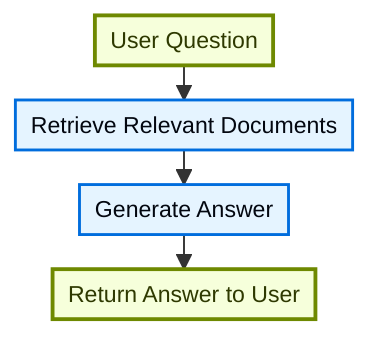
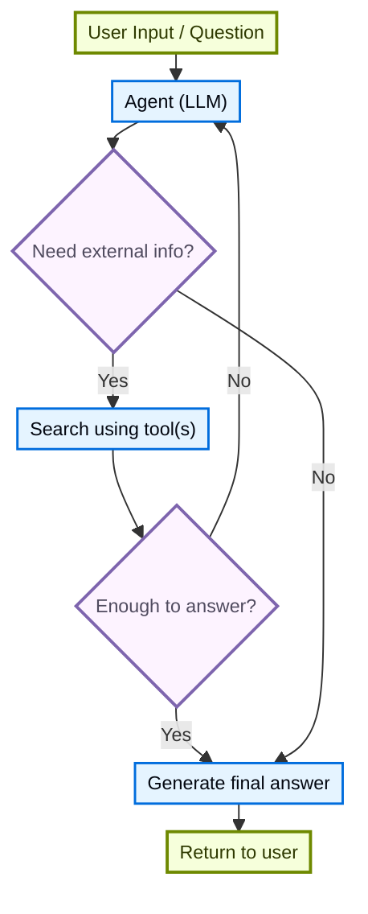
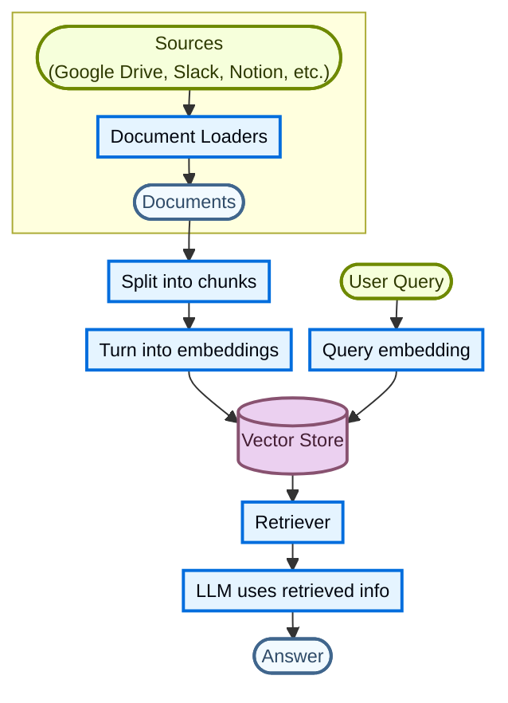

# 真实Agent：0/1/2轮开发回归

同一生成模型、相同初始证据，比较补读上限。没有独立留出题，每格仅运行一次；不能据此证明最优轮数。

引用编号存在不代表支持结论，证据覆盖不代表回答正确。以下语义评分留空，由用户复核。

| 上限 | 完成 | API请求 | 工具调用 | 平均耗时 | 已记录输入/输出tokens |
|---|---:|---:|---:|---:|---:|
| 0 | 3/5 | 5 | 0 | 8.9s | 20019/7453 |
| 1 | 3/5 | 10 | 10 | 8.4s | 43572/6675 |
| 2 | 4/5 | 15 | 10 | 10.3s | 77171/8449 |

部分失败请求可能没有usage，tokens只累计实际收到的用量，不代表失败调用免费。未换算费用。

## u01：完整的RAG应该包括哪些部分

复核重点：检查是否区分基础流水线与生产要求；出处未涵盖的权限、评测等应标为补充解释。

### 最多0轮：failed

耗时11.9s；API请求1次；停止原因：disabled。

文档里没有给“完整 RAG”下一个正式定义；从当前片段看，可以把 RAG 拆成**知识库层、检索构建层、编排层、质量控制层**。但这些是文档列出的常见组成，不等于每个 RAG 都必须全部具备。

## 按文档可归纳的组成部分

### 1. 外部知识库
- 知识库是“检索时使用的文档或结构化数据仓库”[S2]。
- 如果你已经有 SQL 数据库、文档数据库、CRM 或内部文档系统，**不需要重建**：可以把它接成 Agentic RAG 的工具，或先查询再把检索内容作为上下文交给 LLM（2-Step RAG）[S2]。

### 2. 构建可检索知识库的模块
文档列出的 building blocks 包括[S3]：
- **Document loaders**：从 Google Drive、Slack、Notion 等外部来源导入数据，返回标准化 `Document` 对象[S3]。
- **Text splitters**：把大文档切成可单独检索、且能放入模型上下文窗口的 chunk[S3]。
- **Embedding models**：把文本转成向量，使语义相近的文本在向量空间中接近[S3]。
- **Vector stores**：存储和搜索 embedding 的专用数据库[S3]。
- **Retrievers**：给定非结构化查询，返回文档的接口[S3]。

### 3. 检索与生成流程
- RAG 的基本动机是：LLM 有“上下文有限”和“知识静态”两个限制，检索在查询时获取相关外部知识，从而增强答案[S1]。
- **2-Step RAG**：检索步骤总是在生成之前执行，流程是“用户问题 → 检索相关文档 → 生成答案 → 返回用户”[S5]。
- **Agentic RAG**：由 LLM 驱动的 agent 在交互中逐步推理，决定**何时**以及**如何**检索；agent 要具备 RAG 行为，需要能获取外部知识的一个

**人工复核：**条件是否完整：____；引用是否支持：____；是否误导：____；学习帮助：____。

<details><summary>工具轨迹和本轮实际证据</summary>

```json
{
  "version": "reading-agent-v1",
  "rounds": 0,
  "steps": [],
  "stop_reason": "disabled",
  "max_rounds": 0,
  "read_char_budget": 12000
}
```

S1 · Source: Retrieval · 当前阅读快照第3—15行

```text
# Source: Retrieval

---
title: Retrieval
---

Large Language Models (LLMs) are powerful, but they have two key limitations:

* **Finite context**: they can’t ingest entire corpora at once.
* **Static knowledge**: their training data is frozen at a point in time.

Retrieval addresses these problems by fetching relevant external knowledge at query time. This is the foundation of **Retrieval-Augmented Generation (RAG)**, enhancing an LLM’s answers with context-specific information.


```

S2 · Source: Retrieval / Building a knowledge base · 当前阅读快照第16—39行

```text
## Building a knowledge base

A **knowledge base** is a repository of documents or structured data used during retrieval.

If you need a custom knowledge base, you can use LangChain’s document loaders and vector stores to build one from your own data.

<Note>
    If you already have a knowledge base (for example a SQL database, a document database, a CRM, or an internal documentation system), you do **not** need to rebuild it. You can:
    - Connect it as a **tool** for an agent in Agentic RAG.
    - Query it and supply the retrieved content as context to the LLM [(2-Step RAG)](#2-step-rag).
</Note>

For more information, see the following tutorial to build a searchable knowledge base and minimal RAG workflow:

<Card
    title="Tutorial: Semantic search"
    icon="database"
    href="/oss/langchain/knowledge-base"
    arrow cta="Learn more"
>
    Learn how to create a searchable knowledge base from your own data using LangChain’s document loaders, embeddings, and vector stores.
    In this tutorial, you’ll build a search engine over a PDF, enabling retrieval of passages relevant to a query. You’ll also implement a minimal RAG workflow on top of this engine to see how external knowledge can be integrated into LLM reasoning.
</Card>


```

S3 · Source: Retrieval / Building a knowledge base / Building blocks · 当前阅读快照第80—133行

```text
### Building blocks

<Columns cols={2}>
    <Card
        title="Document loaders"
        icon="file-import"
        href="/oss/integrations/document_loaders"
        arrow cta="Learn more"
    >
        Ingest data from external sources (Google Drive, Slack, Notion, etc.), returning standardized @[`Document`] objects.
    </Card>

    :::python
    <Card
        title="Text splitters"
        icon="scissors"
        href="/oss/integrations/splitters"
        arrow
        cta="Learn more"
    >
        Break large docs into smaller chunks that will be retrievable individually and fit within a model's context window.
    </Card>
    :::
    <Card
        title="Embedding models"
        icon="sitemap"
        href="/oss/integrations/embeddings"
        arrow
        cta="Learn more"
    >
        An embedding model turns text into a vector of numbers so that texts with similar meaning land close together in that vector space.
    </Card>

    <Card
        title="Vector stores"
        icon="database"
        href="/oss/integrations/vectorstores/"
        arrow
        cta="Learn more"
    >
        Specialized databases for storing and searching embeddings.
    </Card>

    <Card
        title="Retrievers"
        icon="binoculars"
        href="/oss/integrations/retrievers/"
        arrow
        cta="Learn more"
    >
        A retriever is an interface that returns documents given an unstructured query.
    </Card>
</Columns>


```

S4 · Source: Retrieval / RAG architectures · 当前阅读快照第134—147行

```text
## RAG architectures

RAG can be implemented in multiple ways, depending on your system's needs. We outline each type in the sections below.

| Architecture            | Description                                                                | Control   | Flexibility | Latency        | Example Use Case                                   |
|-------------------------|----------------------------------------------------------------------------|-----------|-------------|----------------|----------------------------------------------------|
| **2-Step RAG**          | Retrieval always happens before generation. Simple and predictable         | ✅ High    | ❌ Low       | ⚡ Fast         | FAQs, documentation bots                           |
| **Agentic RAG**         | An LLM-powered agent decides *when* and *how* to retrieve during reasoning | ❌ Low     | ✅ High      | ⏳ Variable     | Research assistants with access to multiple tools  |
| **Hybrid**              | Combines characteristics of both approaches with validation steps          | ⚖️ Medium | ⚖️ Medium   | ⏳ Variable     | Domain-specific Q&A with quality validation        |

<Info>
**Latency**: Latency is generally more **predictable** in **2-Step RAG**, as the maximum number of LLM calls is known and capped. This predictability assumes that LLM inference time is the dominant factor. However, real-world latency may also be affected by the performance of retrieval steps, such as API response times, network delays, or database queries, which can vary based on the tools and infrastructure in use.
</Info>


```

S5 · Source: Retrieval / RAG architectures / 2-step RAG · 当前阅读快照第148—187行

````text
### 2-step RAG

In **2-Step RAG**, the retrieval step is always executed before the generation step. This architecture is straightforward and predictable, making it suitable for many applications where the retrieval of relevant documents is a clear prerequisite for generating an answer.


<br/>
<CardGroup cols={2}>
    <Card
        title="Tutorial: Semantic search"
        icon="database"
        href="/oss/langchain/knowledge-base"
        arrow
        cta="Learn more"
    >
        Build a searchable knowledge base with document loaders, embeddings, and vector stores, then run a minimal retrieve-then-generate RAG workflow on top of it.
    </Card>
    <Card
        title="Tutorial: Evaluate a RAG application"
        icon="clipboard-check"
        href="/langsmith/evaluate-rag-tutorial"
        arrow
        cta="Learn more"
    >
        Build a simple retrieve-then-generate RAG app and measure answer correctness, relevance, groundedness, and retrieval quality with LangSmith.
    </Card>
</CardGroup>


````

S6 · Source: Retrieval / RAG architectures / Agentic RAG · 当前阅读快照第188—229行

````text
### Agentic RAG

**Agentic Retrieval-Augmented Generation (RAG)** combines the strengths of Retrieval-Augmented Generation with agent-based reasoning. Instead of retrieving documents before answering, an agent (powered by an LLM) reasons step-by-step and decides **when** and **how** to retrieve information during the interaction.

<Tip>
The only thing an agent needs to enable RAG behavior is access to one or more **tools** that can fetch external knowledge, such as documentation loaders, web APIs, or database queries.
</Tip>



:::python
```python
import requests
from langchain.tools import tool
from langchain.chat_models import init_chat_model
from langchain.agents import create_agent


@tool
def fetch_url(url: str) -> str:
    """Fetch text content from a URL"""
    response = requests.get(url, timeout=10.0)

````

S7 · Source: Retrieval / RAG architectures / Hybrid RAG · 当前阅读快照第431—459行

````text
### Hybrid RAG

Hybrid RAG combines characteristics of both 2-Step and Agentic RAG. It introduces intermediate steps such as query preprocessing, retrieval validation, and post-generation checks. These systems offer more flexibility than fixed pipelines while maintaining some control over execution.

Typical components include:

* **Query enhancement**: Modify the input question to improve retrieval quality. This can involve rewriting unclear queries, generating multiple variations, or expanding queries with additional context.
* **Retrieval validation**: Evaluate whether retrieved documents are relevant and sufficient. If not, the system may refine the query and retrieve again.
* **Answer validation**: Check the generated answer for accuracy, completeness, and alignment with source content. If needed, the system can regenerate or revise the answer.

The architecture often supports multiple iterations between these steps:

```mermaid actions={true}
%%{init: {'flowchart': {'nodeSpacing': 12, 'rankSpacing': 18, 'padding': 4}, 'themeVariables': {'fontSize': '12px'}}}%%
graph TB
    A[User Question] --> B[Query Enhancement]
    B --> C[Retrieve Documents]
    C --> D{Sufficient Info?}
    D -- No --> E[Refine Query]
    E --> C
    D -- Yes --> F[Generate Answer]
    F --> G{Answer Quality OK?}
    G -- No --> H{Try Different Approach?}
    H -- Yes --> E
    H -- No --> I[Return Best Answer]
    G -- Yes --> I
    I --> J[Return to User]

    classDef startend fill:#F6FFDB,stroke:#6E8900,stroke-width:2px,color:#2E3900

````

S8 · Source: Retrieval / RAG architectures / Hybrid RAG · 当前阅读快照第460—483行

````text
    classDef decision fill:#FDF3FF,stroke:#7E65AE,stroke-width:2px,color:#504B5F
    classDef process fill:#E5F4FF,stroke:#006DDD,stroke-width:1.5px,color:#030710

    class A,J startend
    class B,C,E,F,I process
    class D,G,H decision
```

This architecture is suitable for:

* Applications with ambiguous or underspecified queries
* Systems that require validation or quality control steps
* Workflows involving multiple sources or iterative refinement

<Card
    title="Tutorial: Agentic RAG with Self-Correction"
    icon="robot"
    href="/oss/langgraph/agentic-rag"
    arrow cta="Learn more"
>
    An example of **Hybrid RAG** that combines agentic reasoning with retrieval and self-correction.
</Card>


````

S9 · Source: Agentic Retrieval Augmented Generation (RAG) · 当前阅读快照第484—485行

```text
# Source: Agentic Retrieval Augmented Generation (RAG)


```

S10 · Agentic Retrieval Augmented Generation (RAG) · 当前阅读快照第486—512行

```text
# Agentic Retrieval Augmented Generation (RAG)

In this unit, we'll be taking a look at how we can use Agentic RAG to help Alfred prepare for the amazing gala.

> [!TIP]
> We know we've already discussed Retrieval Augmented Generation (RAG) and agentic RAG in the previous unit, so feel free to skip ahead if you're already familiar with the concepts.

LLMs are trained on enormous bodies of data to learn general knowledge.
However, the world knowledge model of LLMs may not always be relevant and up-to-date information.
**RAG solves this problem by finding and retrieving relevant information from your data and forwarding that to the LLM.**


Now, think about how Alfred works:

1. We've asked Alfred to help plan a gala
2. Alfred needs to find the latest news and weather information
3. Alfred needs to structure and search the guest information

Just as Alfred needs to search through your household information to be helpful, any agent needs a way to find and understand relevant data.
**Agentic RAG is a powerful way to use agents to answer questions about your data.** We can pass various tools to Alfred to help him answer questions.
However, instead of answering the question on top of documents automatically, Alfred can decide to use any other tool or flow to answer the question.


Let's start **building our agentic RAG workflow!**  


```

</details>

### 最多1轮：failed

耗时12.8s；API请求2次；停止原因：round_limit。

没有回答正文。

**人工复核：**条件是否完整：____；引用是否支持：____；是否误导：____；学习帮助：____。

<details><summary>工具轨迹和本轮实际证据</summary>

```json
{
  "version": "reading-agent-v1",
  "rounds": 1,
  "steps": [
    {
      "round": 1,
      "tool": "read_section",
      "arguments": {
        "start_chunk": 2
      },
      "chunk_indices": [
        2
      ],
      "status": "ok",
      "next_chunk": null
    },
    {
      "round": 1,
      "tool": "read_section",
      "arguments": {
        "start_chunk": 3
      },
      "chunk_indices": [
        3
      ],
      "status": "ok",
      "next_chunk": null
    }
  ],
  "stop_reason": "round_limit",
  "max_rounds": 1,
  "read_char_budget": 12000,
  "retained_chunk_indices": [
    2,
    3,
    0,
    1,
    4,
    5,
    6,
    7,
    12,
    13,
    14
  ],
  "omitted_read_chunks": [],
  "read_chars": 1532,
  "elapsed_ms": 938
}
```

S1 · Source: Retrieval · 当前阅读快照第3—15行

```text
# Source: Retrieval

---
title: Retrieval
---

Large Language Models (LLMs) are powerful, but they have two key limitations:

* **Finite context**: they can’t ingest entire corpora at once.
* **Static knowledge**: their training data is frozen at a point in time.

Retrieval addresses these problems by fetching relevant external knowledge at query time. This is the foundation of **Retrieval-Augmented Generation (RAG)**, enhancing an LLM’s answers with context-specific information.


```

S2 · Source: Retrieval / Building a knowledge base · 当前阅读快照第16—39行

```text
## Building a knowledge base

A **knowledge base** is a repository of documents or structured data used during retrieval.

If you need a custom knowledge base, you can use LangChain’s document loaders and vector stores to build one from your own data.

<Note>
    If you already have a knowledge base (for example a SQL database, a document database, a CRM, or an internal documentation system), you do **not** need to rebuild it. You can:
    - Connect it as a **tool** for an agent in Agentic RAG.
    - Query it and supply the retrieved content as context to the LLM [(2-Step RAG)](#2-step-rag).
</Note>

For more information, see the following tutorial to build a searchable knowledge base and minimal RAG workflow:

<Card
    title="Tutorial: Semantic search"
    icon="database"
    href="/oss/langchain/knowledge-base"
    arrow cta="Learn more"
>
    Learn how to create a searchable knowledge base from your own data using LangChain’s document loaders, embeddings, and vector stores.
    In this tutorial, you’ll build a search engine over a PDF, enabling retrieval of passages relevant to a query. You’ll also implement a minimal RAG workflow on top of this engine to see how external knowledge can be integrated into LLM reasoning.
</Card>


```

S3 · Source: Retrieval / Building a knowledge base / From retrieval to RAG · 当前阅读快照第40—45行

```text
### From retrieval to RAG

Retrieval allows LLMs to access relevant context at runtime. But most real-world applications go one step further: they **integrate retrieval with generation** to produce grounded, context-aware answers.

This is the core idea behind **Retrieval-Augmented Generation (RAG)**. The retrieval pipeline becomes a foundation for a broader system that combines search with generation.


```

S4 · Source: Retrieval / Building a knowledge base / Retrieval pipeline · 当前阅读快照第46—79行

````text
### Retrieval pipeline

A typical retrieval workflow looks like this:


Each component is modular: you can swap loaders, splitters, embeddings, or vector stores without rewriting the app’s logic.


````

S5 · Source: Retrieval / Building a knowledge base / Building blocks · 当前阅读快照第80—133行

```text
### Building blocks

<Columns cols={2}>
    <Card
        title="Document loaders"
        icon="file-import"
        href="/oss/integrations/document_loaders"
        arrow cta="Learn more"
    >
        Ingest data from external sources (Google Drive, Slack, Notion, etc.), returning standardized @[`Document`] objects.
    </Card>

    :::python
    <Card
        title="Text splitters"
        icon="scissors"
        href="/oss/integrations/splitters"
        arrow
        cta="Learn more"
    >
        Break large docs into smaller chunks that will be retrievable individually and fit within a model's context window.
    </Card>
    :::
    <Card
        title="Embedding models"
        icon="sitemap"
        href="/oss/integrations/embeddings"
        arrow
        cta="Learn more"
    >
        An embedding model turns text into a vector of numbers so that texts with similar meaning land close together in that vector space.
    </Card>

    <Card
        title="Vector stores"
        icon="database"
        href="/oss/integrations/vectorstores/"
        arrow
        cta="Learn more"
    >
        Specialized databases for storing and searching embeddings.
    </Card>

    <Card
        title="Retrievers"
        icon="binoculars"
        href="/oss/integrations/retrievers/"
        arrow
        cta="Learn more"
    >
        A retriever is an interface that returns documents given an unstructured query.
    </Card>
</Columns>


```

S6 · Source: Retrieval / RAG architectures · 当前阅读快照第134—147行

```text
## RAG architectures

RAG can be implemented in multiple ways, depending on your system's needs. We outline each type in the sections below.

| Architecture            | Description                                                                | Control   | Flexibility | Latency        | Example Use Case                                   |
|-------------------------|----------------------------------------------------------------------------|-----------|-------------|----------------|----------------------------------------------------|
| **2-Step RAG**          | Retrieval always happens before generation. Simple and predictable         | ✅ High    | ❌ Low       | ⚡ Fast         | FAQs, documentation bots                           |
| **Agentic RAG**         | An LLM-powered agent decides *when* and *how* to retrieve during reasoning | ❌ Low     | ✅ High      | ⏳ Variable     | Research assistants with access to multiple tools  |
| **Hybrid**              | Combines characteristics of both approaches with validation steps          | ⚖️ Medium | ⚖️ Medium   | ⏳ Variable     | Domain-specific Q&A with quality validation        |

<Info>
**Latency**: Latency is generally more **predictable** in **2-Step RAG**, as the maximum number of LLM calls is known and capped. This predictability assumes that LLM inference time is the dominant factor. However, real-world latency may also be affected by the performance of retrieval steps, such as API response times, network delays, or database queries, which can vary based on the tools and infrastructure in use.
</Info>


```

S7 · Source: Retrieval / RAG architectures / 2-step RAG · 当前阅读快照第148—187行

````text
### 2-step RAG

In **2-Step RAG**, the retrieval step is always executed before the generation step. This architecture is straightforward and predictable, making it suitable for many applications where the retrieval of relevant documents is a clear prerequisite for generating an answer.


<br/>
<CardGroup cols={2}>
    <Card
        title="Tutorial: Semantic search"
        icon="database"
        href="/oss/langchain/knowledge-base"
        arrow
        cta="Learn more"
    >
        Build a searchable knowledge base with document loaders, embeddings, and vector stores, then run a minimal retrieve-then-generate RAG workflow on top of it.
    </Card>
    <Card
        title="Tutorial: Evaluate a RAG application"
        icon="clipboard-check"
        href="/langsmith/evaluate-rag-tutorial"
        arrow
        cta="Learn more"
    >
        Build a simple retrieve-then-generate RAG app and measure answer correctness, relevance, groundedness, and retrieval quality with LangSmith.
    </Card>
</CardGroup>


````

S8 · Source: Retrieval / RAG architectures / Agentic RAG · 当前阅读快照第188—229行

````text
### Agentic RAG

**Agentic Retrieval-Augmented Generation (RAG)** combines the strengths of Retrieval-Augmented Generation with agent-based reasoning. Instead of retrieving documents before answering, an agent (powered by an LLM) reasons step-by-step and decides **when** and **how** to retrieve information during the interaction.

<Tip>
The only thing an agent needs to enable RAG behavior is access to one or more **tools** that can fetch external knowledge, such as documentation loaders, web APIs, or database queries.
</Tip>


:::python
```python
import requests
from langchain.tools import tool
from langchain.chat_models import init_chat_model
from langchain.agents import create_agent


@tool
def fetch_url(url: str) -> str:
    """Fetch text content from a URL"""
    response = requests.get(url, timeout=10.0)

````

S9 · Source: Retrieval / RAG architectures / Hybrid RAG · 当前阅读快照第431—459行

````text
### Hybrid RAG

Hybrid RAG combines characteristics of both 2-Step and Agentic RAG. It introduces intermediate steps such as query preprocessing, retrieval validation, and post-generation checks. These systems offer more flexibility than fixed pipelines while maintaining some control over execution.

Typical components include:

* **Query enhancement**: Modify the input question to improve retrieval quality. This can involve rewriting unclear queries, generating multiple variations, or expanding queries with additional context.
* **Retrieval validation**: Evaluate whether retrieved documents are relevant and sufficient. If not, the system may refine the query and retrieve again.
* **Answer validation**: Check the generated answer for accuracy, completeness, and alignment with source content. If needed, the system can regenerate or revise the answer.

The architecture often supports multiple iterations between these steps:

```mermaid actions={true}
%%{init: {'flowchart': {'nodeSpacing': 12, 'rankSpacing': 18, 'padding': 4}, 'themeVariables': {'fontSize': '12px'}}}%%
graph TB
    A[User Question] --> B[Query Enhancement]
    B --> C[Retrieve Documents]
    C --> D{Sufficient Info?}
    D -- No --> E[Refine Query]
    E --> C
    D -- Yes --> F[Generate Answer]
    F --> G{Answer Quality OK?}
    G -- No --> H{Try Different Approach?}
    H -- Yes --> E
    H -- No --> I[Return Best Answer]
    G -- Yes --> I
    I --> J[Return to User]

    classDef startend fill:#F6FFDB,stroke:#6E8900,stroke-width:2px,color:#2E3900

````

S10 · Source: Retrieval / RAG architectures / Hybrid RAG · 当前阅读快照第460—483行

````text
    classDef decision fill:#FDF3FF,stroke:#7E65AE,stroke-width:2px,color:#504B5F
    classDef process fill:#E5F4FF,stroke:#006DDD,stroke-width:1.5px,color:#030710

    class A,J startend
    class B,C,E,F,I process
    class D,G,H decision
```

This architecture is suitable for:

* Applications with ambiguous or underspecified queries
* Systems that require validation or quality control steps
* Workflows involving multiple sources or iterative refinement

<Card
    title="Tutorial: Agentic RAG with Self-Correction"
    icon="robot"
    href="/oss/langgraph/agentic-rag"
    arrow cta="Learn more"
>
    An example of **Hybrid RAG** that combines agentic reasoning with retrieval and self-correction.
</Card>


````

S11 · Source: Agentic Retrieval Augmented Generation (RAG) · 当前阅读快照第484—485行

```text
# Source: Agentic Retrieval Augmented Generation (RAG)


```

</details>

### 最多2轮：completed

耗时12.5s；API请求3次；停止原因：model_stopped。

根据本轮材料，可以把“完整的 RAG”理解为一条**检索 + 生成**的完整链路；但文档用的是“典型检索工作流”的表述，并未断言所有 RAG 都必须包含下面每一项。下面按数据流整理。

## 1. 知识库或数据源：RAG 的外部知识来源

- 知识库被定义为“检索期间使用的文档或结构化数据仓库”[S2]。
- 数据源可以是 Google Drive、Slack、Notion 等[ S4 ]。
- 如果已有 SQL 数据库、文档数据库、CRM 或内部文档系统，文档明确说**不需要重建**，可以直接把它作为 agent 的工具，或先查询它、再把检索内容作为上下文交给 LLM[S2]。

## 2. 索引侧：把原始资料转成可检索的向量

典型流程是：

1. **Document loaders**：从外部来源载入数据，返回标准化的 `Document` 对象[S5]；
2. **Text splitters**：把大文档切成更小的 chunk，使它们可以单独被检索，并适配模型上下文窗口[S5]；
3. **Embedding models**：把文本转成数字向量，让语义相近的文本在向量空间中彼此接近[S5]；
4. **Vector stores**：存储并搜索 embedding 的专用数据库[S5]。

流程图把这条链路表示为：Sources → Document Loaders → Documents → Split into chunks → Turn into embeddings → Vector Store[S4]。

## 3. 查询与检索侧：把用户问题接到知识库

典型流程是：User Query → Query embedding → Vector Store → Retriever[S4]。

其中，**Retriever** 被定义为“给定非结构化查询、返回文档的接口”[S5]。检索本身的目的，是在查询时获取相关外部知识，以缓解 LLM 的两个限制：上下文有限、训练知识静态[S1]。

## 4. 生成侧：把检索结果交给 LLM 生成答案

流程图的最后一段是：Retriever → LLM uses retrieved info → Answer[S4]。在 2-Step RAG 中，这一顺序更明确：用户问题 → 检索相关文档 → 生成答案 → 返回答案[S7]。

文档把“检索与生成整合起来，产生有依据、具备上下文意识的回答”视为 RAG 的核心思想[S3]。因此，完整链路不止于“能检索”，还包括把检索内容用于生成。

## 5. 编排架构：决定检索在何时、以何种方式发生

文档列出三种 RAG 架构[S6]：

- **2-Step RAG**：检索总是在生成之前发生，简单、可预测、延迟较快，适合 FAQ、文档机器人[S6][S7]；
- **Agentic RAG**：由 LLM 驱动的 agent 在推理过程中决定**何时**、**如何**检索[S8]；文档说 agent 要具备 RAG 行为，关键是能访问一个或多个可获取外部知识的**工具**，例如文档加载器、Web API、数据库查询[S8]；
- **Hybrid RAG**：结合两者，并加入中间校验步骤[S9]。

## 6. 质量校验与迭代：Hybrid RAG 的增强部分

Hybrid RAG 的典型组成包括[S9]：

- **Query enhancement**：改写不清楚的问题、生成多个变体，或补充上下文；
- **Retrieval validation**：判断检索文档是否相关且充分，不够则改进查询并再次检索；
- **Answer validation**：检查答案的准确性、完整性和与来源内容的一致性，必要时重新生成或修订。

其流程允许检索与生成之间多次迭代[S9]。这更适合查询含糊、需要质量控制、涉及多来源或迭代细化的场景[S10]。注意：这些校验步骤属于 Hybrid RAG 的描述，不宜反推为所有 RAG 的必备项。

## 小结

按文档可归纳为：**知识库/数据源 → 文档加载 → 切分 → 向量化 → 向量存储 → 查询向量化 → 检索器 → LLM 结合检索内容生成答案**；在此之上，再选择 2-Step、Agentic 或 Hybrid 的编排方式，Hybrid 还可加入查询增强、检索校验和答案校验[S4][S5][S9]。

适用条件与限制：以上是文档所述的“典型”检索工作流，且各组件被描述为可替换的模块[S4]；材料为部分文档，不能据此断言全文对所有 RAG 形态给出了穷尽式组件清单。此外，2-Step RAG 的延迟可预测性有前提——假设 LLM 推理时间是主导因素，实际还会受 API、网络、数据库查询等检索步骤影响[S6]。

**人工复核：**条件是否完整：____；引用是否支持：____；是否误导：____；学习帮助：____。

<details><summary>工具轨迹和本轮实际证据</summary>

```json
{
  "version": "reading-agent-v1",
  "rounds": 2,
  "steps": [
    {
      "round": 1,
      "tool": "read_section",
      "arguments": {
        "start_chunk": 2
      },
      "chunk_indices": [
        2
      ],
      "status": "ok",
      "next_chunk": null
    },
    {
      "round": 1,
      "tool": "read_section",
      "arguments": {
        "start_chunk": 3
      },
      "chunk_indices": [
        3
      ],
      "status": "ok",
      "next_chunk": null
    }
  ],
  "stop_reason": "model_stopped",
  "max_rounds": 2,
  "read_char_budget": 12000,
  "retained_chunk_indices": [
    2,
    3,
    0,
    1,
    4,
    5,
    6,
    7,
    12,
    13,
    14
  ],
  "omitted_read_chunks": [],
  "read_chars": 1532,
  "elapsed_ms": 4406
}
```

S1 · Source: Retrieval · 当前阅读快照第3—15行

```text
# Source: Retrieval

---
title: Retrieval
---

Large Language Models (LLMs) are powerful, but they have two key limitations:

* **Finite context**: they can’t ingest entire corpora at once.
* **Static knowledge**: their training data is frozen at a point in time.

Retrieval addresses these problems by fetching relevant external knowledge at query time. This is the foundation of **Retrieval-Augmented Generation (RAG)**, enhancing an LLM’s answers with context-specific information.


```

S2 · Source: Retrieval / Building a knowledge base · 当前阅读快照第16—39行

```text
## Building a knowledge base

A **knowledge base** is a repository of documents or structured data used during retrieval.

If you need a custom knowledge base, you can use LangChain’s document loaders and vector stores to build one from your own data.

<Note>
    If you already have a knowledge base (for example a SQL database, a document database, a CRM, or an internal documentation system), you do **not** need to rebuild it. You can:
    - Connect it as a **tool** for an agent in Agentic RAG.
    - Query it and supply the retrieved content as context to the LLM [(2-Step RAG)](#2-step-rag).
</Note>

For more information, see the following tutorial to build a searchable knowledge base and minimal RAG workflow:

<Card
    title="Tutorial: Semantic search"
    icon="database"
    href="/oss/langchain/knowledge-base"
    arrow cta="Learn more"
>
    Learn how to create a searchable knowledge base from your own data using LangChain’s document loaders, embeddings, and vector stores.
    In this tutorial, you’ll build a search engine over a PDF, enabling retrieval of passages relevant to a query. You’ll also implement a minimal RAG workflow on top of this engine to see how external knowledge can be integrated into LLM reasoning.
</Card>


```

S3 · Source: Retrieval / Building a knowledge base / From retrieval to RAG · 当前阅读快照第40—45行

```text
### From retrieval to RAG

Retrieval allows LLMs to access relevant context at runtime. But most real-world applications go one step further: they **integrate retrieval with generation** to produce grounded, context-aware answers.

This is the core idea behind **Retrieval-Augmented Generation (RAG)**. The retrieval pipeline becomes a foundation for a broader system that combines search with generation.


```

S4 · Source: Retrieval / Building a knowledge base / Retrieval pipeline · 当前阅读快照第46—79行

````text
### Retrieval pipeline

A typical retrieval workflow looks like this:



Each component is modular: you can swap loaders, splitters, embeddings, or vector stores without rewriting the app’s logic.


````

S5 · Source: Retrieval / Building a knowledge base / Building blocks · 当前阅读快照第80—133行

```text
### Building blocks

<Columns cols={2}>
    <Card
        title="Document loaders"
        icon="file-import"
        href="/oss/integrations/document_loaders"
        arrow cta="Learn more"
    >
        Ingest data from external sources (Google Drive, Slack, Notion, etc.), returning standardized @[`Document`] objects.
    </Card>

    :::python
    <Card
        title="Text splitters"
        icon="scissors"
        href="/oss/integrations/splitters"
        arrow
        cta="Learn more"
    >
        Break large docs into smaller chunks that will be retrievable individually and fit within a model's context window.
    </Card>
    :::
    <Card
        title="Embedding models"
        icon="sitemap"
        href="/oss/integrations/embeddings"
        arrow
        cta="Learn more"
    >
        An embedding model turns text into a vector of numbers so that texts with similar meaning land close together in that vector space.
    </Card>

    <Card
        title="Vector stores"
        icon="database"
        href="/oss/integrations/vectorstores/"
        arrow
        cta="Learn more"
    >
        Specialized databases for storing and searching embeddings.
    </Card>

    <Card
        title="Retrievers"
        icon="binoculars"
        href="/oss/integrations/retrievers/"
        arrow
        cta="Learn more"
    >
        A retriever is an interface that returns documents given an unstructured query.
    </Card>
</Columns>


```

S6 · Source: Retrieval / RAG architectures · 当前阅读快照第134—147行

```text
## RAG architectures

RAG can be implemented in multiple ways, depending on your system's needs. We outline each type in the sections below.

| Architecture            | Description                                                                | Control   | Flexibility | Latency        | Example Use Case                                   |
|-------------------------|----------------------------------------------------------------------------|-----------|-------------|----------------|----------------------------------------------------|
| **2-Step RAG**          | Retrieval always happens before generation. Simple and predictable         | ✅ High    | ❌ Low       | ⚡ Fast         | FAQs, documentation bots                           |
| **Agentic RAG**         | An LLM-powered agent decides *when* and *how* to retrieve during reasoning | ❌ Low     | ✅ High      | ⏳ Variable     | Research assistants with access to multiple tools  |
| **Hybrid**              | Combines characteristics of both approaches with validation steps          | ⚖️ Medium | ⚖️ Medium   | ⏳ Variable     | Domain-specific Q&A with quality validation        |

<Info>
**Latency**: Latency is generally more **predictable** in **2-Step RAG**, as the maximum number of LLM calls is known and capped. This predictability assumes that LLM inference time is the dominant factor. However, real-world latency may also be affected by the performance of retrieval steps, such as API response times, network delays, or database queries, which can vary based on the tools and infrastructure in use.
</Info>


```

S7 · Source: Retrieval / RAG architectures / 2-step RAG · 当前阅读快照第148—187行

````text
### 2-step RAG

In **2-Step RAG**, the retrieval step is always executed before the generation step. This architecture is straightforward and predictable, making it suitable for many applications where the retrieval of relevant documents is a clear prerequisite for generating an answer.


<br/>
<CardGroup cols={2}>
    <Card
        title="Tutorial: Semantic search"
        icon="database"
        href="/oss/langchain/knowledge-base"
        arrow
        cta="Learn more"
    >
        Build a searchable knowledge base with document loaders, embeddings, and vector stores, then run a minimal retrieve-then-generate RAG workflow on top of it.
    </Card>
    <Card
        title="Tutorial: Evaluate a RAG application"
        icon="clipboard-check"
        href="/langsmith/evaluate-rag-tutorial"
        arrow
        cta="Learn more"
    >
        Build a simple retrieve-then-generate RAG app and measure answer correctness, relevance, groundedness, and retrieval quality with LangSmith.
    </Card>
</CardGroup>


````

S8 · Source: Retrieval / RAG architectures / Agentic RAG · 当前阅读快照第188—229行

````text
### Agentic RAG

**Agentic Retrieval-Augmented Generation (RAG)** combines the strengths of Retrieval-Augmented Generation with agent-based reasoning. Instead of retrieving documents before answering, an agent (powered by an LLM) reasons step-by-step and decides **when** and **how** to retrieve information during the interaction.

<Tip>
The only thing an agent needs to enable RAG behavior is access to one or more **tools** that can fetch external knowledge, such as documentation loaders, web APIs, or database queries.
</Tip>


:::python
```python
import requests
from langchain.tools import tool
from langchain.chat_models import init_chat_model
from langchain.agents import create_agent


@tool
def fetch_url(url: str) -> str:
    """Fetch text content from a URL"""
    response = requests.get(url, timeout=10.0)

````

S9 · Source: Retrieval / RAG architectures / Hybrid RAG · 当前阅读快照第431—459行

````text
### Hybrid RAG

Hybrid RAG combines characteristics of both 2-Step and Agentic RAG. It introduces intermediate steps such as query preprocessing, retrieval validation, and post-generation checks. These systems offer more flexibility than fixed pipelines while maintaining some control over execution.

Typical components include:

* **Query enhancement**: Modify the input question to improve retrieval quality. This can involve rewriting unclear queries, generating multiple variations, or expanding queries with additional context.
* **Retrieval validation**: Evaluate whether retrieved documents are relevant and sufficient. If not, the system may refine the query and retrieve again.
* **Answer validation**: Check the generated answer for accuracy, completeness, and alignment with source content. If needed, the system can regenerate or revise the answer.

The architecture often supports multiple iterations between these steps:

```mermaid actions={true}
%%{init: {'flowchart': {'nodeSpacing': 12, 'rankSpacing': 18, 'padding': 4}, 'themeVariables': {'fontSize': '12px'}}}%%
graph TB
    A[User Question] --> B[Query Enhancement]
    B --> C[Retrieve Documents]
    C --> D{Sufficient Info?}
    D -- No --> E[Refine Query]
    E --> C
    D -- Yes --> F[Generate Answer]
    F --> G{Answer Quality OK?}
    G -- No --> H{Try Different Approach?}
    H -- Yes --> E
    H -- No --> I[Return Best Answer]
    G -- Yes --> I
    I --> J[Return to User]

    classDef startend fill:#F6FFDB,stroke:#6E8900,stroke-width:2px,color:#2E3900

````

S10 · Source: Retrieval / RAG architectures / Hybrid RAG · 当前阅读快照第460—483行

````text
    classDef decision fill:#FDF3FF,stroke:#7E65AE,stroke-width:2px,color:#504B5F
    classDef process fill:#E5F4FF,stroke:#006DDD,stroke-width:1.5px,color:#030710

    class A,J startend
    class B,C,E,F,I process
    class D,G,H decision
```

This architecture is suitable for:

* Applications with ambiguous or underspecified queries
* Systems that require validation or quality control steps
* Workflows involving multiple sources or iterative refinement

<Card
    title="Tutorial: Agentic RAG with Self-Correction"
    icon="robot"
    href="/oss/langgraph/agentic-rag"
    arrow cta="Learn more"
>
    An example of **Hybrid RAG** that combines agentic reasoning with retrieval and self-correction.
</Card>


````

S11 · Source: Agentic Retrieval Augmented Generation (RAG) · 当前阅读快照第484—485行

```text
# Source: Agentic Retrieval Augmented Generation (RAG)


```

</details>

## u02：怎么保证agent结构化输出

复核重点：检查是否区分格式/Schema约束与语义正确，说明能力条件、校验、失败处理，避免保证永不出错。

### 最多0轮：failed

耗时11.9s；API请求1次；停止原因：disabled。

没有回答正文。

**人工复核：**条件是否完整：____；引用是否支持：____；是否误导：____；学习帮助：____。

<details><summary>工具轨迹和本轮实际证据</summary>

```json
{
  "version": "reading-agent-v1",
  "rounds": 0,
  "steps": [],
  "stop_reason": "disabled",
  "max_rounds": 0,
  "read_char_budget": 12000
}
```

S1 · 正文 · 当前阅读快照第1—26行

````text
---
title: Structured output
---

:::python

Structured output allows agents to return data in a specific, predictable format. Instead of parsing natural language responses, you get structured data in the form of JSON objects, [Pydantic models](https://docs.pydantic.dev/latest/concepts/models/#basic-model-usage), or dataclasses that your application can use directly.

<Tip>
This page covers structured output with agents using `create_agent`. To use structured output directly on a model (outside of agents), see [Models - Structured output](/oss/langchain/models#structured-output).
</Tip>

LangChain's @[`create_agent`] handles structured output automatically. The user sets their desired structured output schema, and when the model generates the structured data, it's captured, validated, and returned in the `'structured_response'` key of the agent's state.

```python
def create_agent(
    ...
    response_format: Union[
        ToolStrategy[StructuredResponseT],
        ProviderStrategy[StructuredResponseT],
        type[StructuredResponseT],
        None,
    ]
)
```


````

S2 · Response format · 当前阅读快照第27—56行

````text
## Response format

Use `response_format` to control how the agent returns structured data:

- **`ToolStrategy[StructuredResponseT]`**: Uses tool calling for structured output
- **`ProviderStrategy[StructuredResponseT]`**: Uses provider-native structured output
- **`type[StructuredResponseT]`**: Schema type - automatically selects best strategy based on model capabilities
- **`None`**: Structured output not explicitly requested

When a schema type is provided directly, LangChain automatically chooses:

- `ProviderStrategy` if the model and provider chosen supports native structured output (e.g. [OpenAI](/oss/integrations/providers/openai), [Anthropic (Claude)](/oss/integrations/providers/anthropic), or [xAI (Grok)](/oss/integrations/providers/xai)).
- `ToolStrategy` for all other models.

<Warning>
JSON Schema dictionaries must be wrapped in an explicit strategy (`ProviderStrategy` or `ToolStrategy`). They are not automatically detected when passed directly to `response_format`.
</Warning>

<Note>
    Support for native structured output features is read dynamically from the model's [profile data](/oss/langchain/models#model-profiles) if using `langchain>=1.1`. If data are not available, use another condition or specify manually:
    ```python
    custom_profile = {
        "structured_output": True,
        # ...
    }
    model = init_chat_model("...", profile=custom_profile)
    ```
    If tools are specified, the model must support simultaneous use of tools and structured output.
</Note>


````

S3 · Response format · 当前阅读快照第57—80行

````text
The structured response is returned in the `structured_response` key of the agent's final state.
:::
:::js
Structured output allows agents to return data in a specific, predictable format. Instead of parsing natural language responses, you get typed structured data.

<Tip>
This page covers structured output with agents using `createAgent`. To use structured output directly on a model (outside of agents), see [Models - Structured output](/oss/langchain/models#structured-output).
</Tip>

LangChain's prebuilt ReAct agent `createAgent` handles structured output automatically. The user sets their desired structured output schema, and when the model generates the structured data, it's captured, validated, and returned in the `structuredResponse` key of the agent's state.

```ts
type ResponseFormat = (
    | ZodSchema<StructuredResponseT> // a Zod schema
    | StandardSchema<StructuredResponseT> // any Standard Schema library
    | Record<string, unknown> // a JSON Schema
)

const agent = createAgent({
    // ...
    responseFormat: ResponseFormat | ResponseFormat[]
})
```


````

S4 · Response format · 当前阅读快照第81—112行

````text
## Response format

Controls how the agent returns structured data. You can provide a Zod schema, any [Standard Schema](https://standardschema.dev/)-compatible schema, or a JSON Schema object. By default, the agent uses a tool calling strategy, in which the output is created by an additional tool call. Certain models support native structured output, in which case the agent will use that strategy instead.

You can control the behavior by wrapping `ResponseFormat` in a `toolStrategy` or `providerStrategy` function call:

```ts
import { toolStrategy, providerStrategy } from "langchain";

const agent = createAgent({
    // use a provider strategy if supported by the model
    responseFormat: providerStrategy(z.object({ ... }))
    // or enforce a tool strategy
    responseFormat: toolStrategy(z.object({ ... }))
})
```

The structured response is returned in the `structuredResponse` key of the agent's final state.

<Tip>
    Support for native structured output features is read dynamically from the model's [profile data](/oss/langchain/models#model-profiles) if using `langchain>=1.1`. If data are not available, use another condition or specify manually:
    ```typescript
    const customProfile: ModelProfile = {
        structuredOutput: true,
        // ...
    }
    const model = await initChatModel("...", { profile: customProfile });
    ```
    If tools are specified, the model must support simultaneous use of tools and structured output.
</Tip>
:::


````

S5 · Provider strategy · 当前阅读快照第113—149行

````text
## Provider strategy

Some model providers support structured output natively through their APIs (e.g. OpenAI, xAI (Grok), Gemini, Anthropic (Claude)). This is the most reliable method when available.

To use this strategy, configure a `ProviderStrategy`:

:::python
```python
class ProviderStrategy(Generic[SchemaT]):
    schema: type[SchemaT]
    strict: bool | None = None
```
<Info>
    The `strict` param requires `langchain>=1.2`.
</Info>

<ParamField path="schema" required>
    The schema defining the structured output format. Supports:
    - **Pydantic models**: `BaseModel` subclasses with field validation. Returns validated Pydantic instance.
    - **Dataclasses**: Python dataclasses with type annotations. Returns dict.
    - **TypedDict**: Typed dictionary classes. Returns dict.
    - **JSON Schema**: Dictionary with JSON schema specification. Must include top-level `title` and `description` keys. Returns dict.
</ParamField>

<ParamField path="strict">
    Optional boolean parameter to enable strict schema adherence. Supported by some providers (e.g., [OpenAI](/oss/integrations/chat/openai) and [xAI](/oss/integrations/chat/xai)). Defaults to `None` (disabled).
</ParamField>

LangChain automatically uses `ProviderStrategy` when you pass a schema type directly to @[`create_agent.response_format`][create_agent(response_format)] and the model supports native structured output:

<CodeGroup>
    ```python Pydantic Model
    from pydantic import BaseModel, Field
    from langchain.agents import create_agent


    class ContactInfo(BaseModel):

````

S6 · Provider strategy · 当前阅读快照第150—198行

````text
        """Contact information for a person."""
        name: str = Field(description="The name of the person")
        email: str = Field(description="The email address of the person")
        phone: str = Field(description="The phone number of the person")

    agent = create_agent(
        model="gpt-5.5",
        response_format=ContactInfo  # Auto-selects ProviderStrategy
    )

    result = agent.invoke({
        "messages": [{"role": "user", "content": "Extract contact info from: John Doe, john@example.com, (555) 123-4567"}]
    })

    print(result["structured_response"])
    # ContactInfo(name='John Doe', email='john@example.com', phone='(555) 123-4567')
    ```

    ```python Dataclass
    from dataclasses import dataclass
    from langchain.agents import create_agent


    @dataclass
    class ContactInfo:
        """Contact information for a person."""
        name: str # The name of the person
        email: str # The email address of the person
        phone: str # The phone number of the person

    agent = create_agent(
        model="gpt-5.5",
        tools=[],
        response_format=ContactInfo  # Auto-selects ProviderStrategy
    )

    result = agent.invoke({
        "messages": [{"role": "user", "content": "Extract contact info from: John Doe, john@example.com, (555) 123-4567"}]
    })

    result["structured_response"]
    # {'name': 'John Doe', 'email': 'john@example.com', 'phone': '(555) 123-4567'}
    ```

    ```python TypedDict
    from typing_extensions import TypedDict
    from langchain.agents import create_agent


````

S7 · Provider strategy · 当前阅读快照第199—245行

````text
    class ContactInfo(TypedDict):
        """Contact information for a person."""
        name: str # The name of the person
        email: str # The email address of the person
        phone: str # The phone number of the person

    agent = create_agent(
        model="gpt-5.5",
        tools=[],
        response_format=ContactInfo  # Auto-selects ProviderStrategy
    )

    result = agent.invoke({
        "messages": [{"role": "user", "content": "Extract contact info from: John Doe, john@example.com, (555) 123-4567"}]
    })

    result["structured_response"]
    # {'name': 'John Doe', 'email': 'john@example.com', 'phone': '(555) 123-4567'}
    ```

    ```python JSON Schema
    from langchain.agents import create_agent
    from langchain.agents.structured_output import ProviderStrategy


    contact_info_schema = {
        "title": "ContactInfo",
        "type": "object",
        "description": "Contact information for a person.",
        "properties": {
            "name": {"type": "string", "description": "The name of the person"},
            "email": {"type": "string", "description": "The email address of the person"},
            "phone": {"type": "string", "description": "The phone number of the person"}
        },
        "required": ["name", "email", "phone"]
    }

    agent = create_agent(
        model="gpt-5.5",
        tools=[],
        response_format=ProviderStrategy(contact_info_schema)
    )

    result = agent.invoke({
        "messages": [{"role": "user", "content": "Extract contact info from: John Doe, john@example.com, (555) 123-4567"}]
    })


````

S8 · Tool calling strategy · 当前阅读快照第366—403行

````text
## Tool calling strategy

For models that don't support native structured output, LangChain uses tool calling to achieve the same result. This works with all models that support tool calling (most modern models).

To use this strategy, configure a `ToolStrategy`:

:::python
```python
class ToolStrategy(Generic[SchemaT]):
    schema: type[SchemaT]
    tool_message_content: str | None
    handle_errors: Union[
        bool,
        str,
        type[Exception],
        tuple[type[Exception], ...],
        Callable[[Exception], str],
    ]
```

<ParamField path="schema" required>
    The schema defining the structured output format. Supports:
    - **Pydantic models**: `BaseModel` subclasses with field validation. Returns validated Pydantic instance.
    - **Dataclasses**: Python dataclasses with type annotations. Returns dict.
    - **TypedDict**: Typed dictionary classes. Returns dict.
    - **JSON Schema**: Dictionary with JSON schema specification. Must include top-level `title` and `description` keys. Returns dict.
    - **Union types**: Multiple schema options. The model will choose the most appropriate schema based on the context.
</ParamField>

<ParamField path="tool_message_content">
    Custom content for the tool message returned when structured output is generated.
    If not provided, defaults to a message showing the structured response data.
</ParamField>

<ParamField path="handle_errors">
    Error handling strategy for structured output validation failures. Defaults to `True`.

    - **`True`**: Catch all errors with default error template

````

S9 · Tool calling strategy / Error handling · 当前阅读快照第835—838行

```text
### Error handling

Models can make mistakes when generating structured output via tool calling. LangChain provides intelligent retry mechanisms to handle these errors automatically.


```

S10 · Tool calling strategy / Error handling / Schema validation error · 当前阅读快照第1007—1015行

````text
  Args:
    rating: 5
    comment: Amazing product
================================= Tool Message =================================
Name: ProductRating

Returning structured response: {'rating': 5, 'comment': 'Amazing product'}
```


````

</details>

### 最多1轮：failed

耗时13.2s；API请求2次；停止原因：round_limit。

没有回答正文。

**人工复核：**条件是否完整：____；引用是否支持：____；是否误导：____；学习帮助：____。

<details><summary>工具轨迹和本轮实际证据</summary>

```json
{
  "version": "reading-agent-v1",
  "rounds": 1,
  "steps": [
    {
      "round": 1,
      "tool": "read_section",
      "arguments": {
        "start_chunk": 22
      },
      "chunk_indices": [
        22,
        23,
        24,
        25
      ],
      "status": "ok",
      "next_chunk": 26
    },
    {
      "round": 1,
      "tool": "read_section",
      "arguments": {
        "start_chunk": 28
      },
      "chunk_indices": [
        28,
        29,
        30
      ],
      "status": "ok",
      "next_chunk": 31
    }
  ],
  "stop_reason": "round_limit",
  "max_rounds": 1,
  "read_char_budget": 12000,
  "retained_chunk_indices": [
    22,
    23,
    24,
    25,
    28,
    29,
    30,
    0,
    1,
    27
  ],
  "omitted_read_chunks": [],
  "read_chars": 9142,
  "elapsed_ms": 922
}
```

S1 · 正文 · 当前阅读快照第1—26行

````text
---
title: Structured output
---

:::python

Structured output allows agents to return data in a specific, predictable format. Instead of parsing natural language responses, you get structured data in the form of JSON objects, [Pydantic models](https://docs.pydantic.dev/latest/concepts/models/#basic-model-usage), or dataclasses that your application can use directly.

<Tip>
This page covers structured output with agents using `create_agent`. To use structured output directly on a model (outside of agents), see [Models - Structured output](/oss/langchain/models#structured-output).
</Tip>

LangChain's @[`create_agent`] handles structured output automatically. The user sets their desired structured output schema, and when the model generates the structured data, it's captured, validated, and returned in the `'structured_response'` key of the agent's state.

```python
def create_agent(
    ...
    response_format: Union[
        ToolStrategy[StructuredResponseT],
        ProviderStrategy[StructuredResponseT],
        type[StructuredResponseT],
        None,
    ]
)
```


````

S2 · Response format · 当前阅读快照第27—56行

````text
## Response format

Use `response_format` to control how the agent returns structured data:

- **`ToolStrategy[StructuredResponseT]`**: Uses tool calling for structured output
- **`ProviderStrategy[StructuredResponseT]`**: Uses provider-native structured output
- **`type[StructuredResponseT]`**: Schema type - automatically selects best strategy based on model capabilities
- **`None`**: Structured output not explicitly requested

When a schema type is provided directly, LangChain automatically chooses:

- `ProviderStrategy` if the model and provider chosen supports native structured output (e.g. [OpenAI](/oss/integrations/providers/openai), [Anthropic (Claude)](/oss/integrations/providers/anthropic), or [xAI (Grok)](/oss/integrations/providers/xai)).
- `ToolStrategy` for all other models.

<Warning>
JSON Schema dictionaries must be wrapped in an explicit strategy (`ProviderStrategy` or `ToolStrategy`). They are not automatically detected when passed directly to `response_format`.
</Warning>

<Note>
    Support for native structured output features is read dynamically from the model's [profile data](/oss/langchain/models#model-profiles) if using `langchain>=1.1`. If data are not available, use another condition or specify manually:
    ```python
    custom_profile = {
        "structured_output": True,
        # ...
    }
    model = init_chat_model("...", profile=custom_profile)
    ```
    If tools are specified, the model must support simultaneous use of tools and structured output.
</Note>


````

S3 · Tool calling strategy / Error handling · 当前阅读快照第835—838行

```text
### Error handling

Models can make mistakes when generating structured output via tool calling. LangChain provides intelligent retry mechanisms to handle these errors automatically.


```

S4 · Tool calling strategy / Error handling / Multiple structured outputs error · 当前阅读快照第839—889行

````text
#### Multiple structured outputs error

When a model incorrectly calls multiple structured output tools, the agent provides error feedback in a @[`ToolMessage`] and prompts the model to retry:

:::python
```python
from pydantic import BaseModel, Field
from typing import Union
from langchain.agents import create_agent
from langchain.agents.structured_output import ToolStrategy


class ContactInfo(BaseModel):
    name: str = Field(description="Person's name")
    email: str = Field(description="Email address")

class EventDetails(BaseModel):
    event_name: str = Field(description="Name of the event")
    date: str = Field(description="Event date")

agent = create_agent(
    model="gpt-5.5",
    tools=[],
    response_format=ToolStrategy(Union[ContactInfo, EventDetails])  # Default: handle_errors=True
)

agent.invoke({
    "messages": [{"role": "user", "content": "Extract info: John Doe (john@email.com) is organizing Tech Conference on March 15th"}]
})
```

```
================================ Human Message =================================

Extract info: John Doe (john@email.com) is organizing Tech Conference on March 15th
None
================================== Ai Message ==================================
Tool Calls:
  ContactInfo (call_1)
 Call ID: call_1
  Args:
    name: John Doe
    email: john@email.com
  EventDetails (call_2)
 Call ID: call_2
  Args:
    event_name: Tech Conference
    date: March 15th
================================= Tool Message =================================
Name: ContactInfo


````

S5 · Tool calling strategy / Error handling / Multiple structured outputs error · 当前阅读快照第890—945行

````text
Error: Model incorrectly returned multiple structured responses (ContactInfo, EventDetails) when only one is expected.
 Please fix your mistakes.
================================= Tool Message =================================
Name: EventDetails

Error: Model incorrectly returned multiple structured responses (ContactInfo, EventDetails) when only one is expected.
 Please fix your mistakes.
================================== Ai Message ==================================
Tool Calls:
  ContactInfo (call_3)
 Call ID: call_3
  Args:
    name: John Doe
    email: john@email.com
================================= Tool Message =================================
Name: ContactInfo

Returning structured response: {'name': 'John Doe', 'email': 'john@email.com'}
```
:::
:::js
```ts
import * as z from "zod";
import { createAgent, toolStrategy } from "langchain";

const ContactInfo = z.object({
    name: z.string().describe("Person's name"),
    email: z.string().describe("Email address"),
});

const EventDetails = z.object({
    event_name: z.string().describe("Name of the event"),
    date: z.string().describe("Event date"),
});

const agent = createAgent({
    model: "gpt-5.5",
    tools: [],
    responseFormat: toolStrategy([ContactInfo, EventDetails]),
});

const result = await agent.invoke({
    messages: [
        {
        role: "user",
        content:
            "Extract info: John Doe (john@email.com) is organizing Tech Conference on March 15th",
        },
    ],
});

console.log(result);

/**
 * {
 *   messages: [

````

S6 · Tool calling strategy / Error handling / Multiple structured outputs error · 当前阅读快照第946—958行

````text
 *     { role: "user", content: "Extract info: John Doe (john@email.com) is organizing Tech Conference on March 15th" },
 *     { role: "assistant", content: "", tool_calls: [ { name: "ContactInfo", args: { name: "John Doe", email: "john@email.com" }, id: "call_1" }, { name: "EventDetails", args: { event_name: "Tech Conference", date: "March 15th" }, id: "call_2" } ] },
 *     { role: "tool", content: "Error: Model incorrectly returned multiple structured responses (ContactInfo, EventDetails) when only one is expected.\n Please fix your mistakes.", tool_call_id: "call_1", name: "ContactInfo" },
 *     { role: "tool", content: "Error: Model incorrectly returned multiple structured responses (ContactInfo, EventDetails) when only one is expected.\n Please fix your mistakes.", tool_call_id: "call_2", name: "EventDetails" },
 *     { role: "assistant", content: "", tool_calls: [ { name: "ContactInfo", args: { name: "John Doe", email: "john@email.com" }, id: "call_3" } ] },
 *     { role: "tool", content: "Returning structured response: {'name': 'John Doe', 'email': 'john@email.com'}", tool_call_id: "call_3", name: "ContactInfo" }
 *   ],
 *   structuredResponse: { name: "John Doe", email: "john@email.com" }
 * }
 */
```
:::


````

S7 · Tool calling strategy / Error handling / Schema validation error · 当前阅读快照第1007—1015行

````text
  Args:
    rating: 5
    comment: Amazing product
================================= Tool Message =================================
Name: ProductRating

Returning structured response: {'rating': 5, 'comment': 'Amazing product'}
```


````

S8 · Tool calling strategy / Error handling / Error handling strategies · 当前阅读快照第1016—1063行

````text
#### Error handling strategies

You can customize how errors are handled using the `handle_errors` parameter:

**Custom error message:**
```python
ToolStrategy(
    schema=ProductRating,
    handle_errors="Please provide a valid rating between 1-5 and include a comment."
)
```
If `handle_errors` is a string, the agent will *always* prompt the model to re-try with a fixed tool message:
```
================================= Tool Message =================================
Name: ProductRating

Please provide a valid rating between 1-5 and include a comment.
```

**Handle specific exceptions only:**

```python
ToolStrategy(
    schema=ProductRating,
    handle_errors=ValueError  # Only retry on ValueError, raise others
)
```

If `handle_errors` is an exception type, the agent will only retry (using the default error message) if the exception raised is the specified type. In all other cases, the exception will be raised.

**Handle multiple exception types:**
```python
ToolStrategy(
    schema=ProductRating,
    handle_errors=(ValueError, TypeError)  # Retry on ValueError and TypeError
)
```

If `handle_errors` is a tuple of exceptions, the agent will only retry (using the default error message) if the exception raised is one of the specified types. In all other cases, the exception will be raised.

**Custom error handler function:**

```python

from langchain.agents.structured_output import StructuredOutputValidationError
from langchain.agents.structured_output import MultipleStructuredOutputsError

def custom_error_handler(error: Exception) -> str:

````

S9 · Tool calling strategy / Error handling / Error handling strategies · 当前阅读快照第1064—1114行

````text
    if isinstance(error, StructuredOutputValidationError):
        return "There was an issue with the format. Try again."
    elif isinstance(error, MultipleStructuredOutputsError):
        return "Multiple structured outputs were returned. Pick the most relevant one."
    else:
        return f"Error: {str(error)}"


agent = create_agent(
    model="gpt-5.5",
    tools=[],
    response_format=ToolStrategy(
                        schema=Union[ContactInfo, EventDetails],
                        handle_errors=custom_error_handler
                    )  # Default: handle_errors=True
)

result = agent.invoke({
    "messages": [{"role": "user", "content": "Extract info: John Doe (john@email.com) is organizing Tech Conference on March 15th"}]
})

for msg in result['messages']:
    # If message is actually a ToolMessage object (not a dict), check its class name
    if type(msg).__name__ == "ToolMessage":
        print(msg.content)
    # If message is a dictionary or you want a fallback
    elif isinstance(msg, dict) and msg.get('tool_call_id'):
        print(msg['content'])

```

On `StructuredOutputValidationError`:
```
================================= Tool Message =================================
Name: ToolStrategy

There was an issue with the format. Try again.
```

On `MultipleStructuredOutputsError`:

```
================================= Tool Message =================================
Name: ToolStrategy

Multiple structured outputs were returned. Pick the most relevant one.
```

On other errors:

```

````

S10 · Tool calling strategy / Error handling / Error handling strategies · 当前阅读快照第1115—1163行

````text
================================= Tool Message =================================
Name: ToolStrategy

Error: <error message>
```

**No error handling:**

```python
response_format = ToolStrategy(
    schema=ProductRating,
    handle_errors=False  # All errors raised
)
```
:::
:::js
```ts
import * as z from "zod";
import { createAgent, toolStrategy } from "langchain";

const ProductRating = z.object({
    rating: z.number().min(1).max(5).describe("Rating from 1-5"),
    comment: z.string().describe("Review comment"),
});

const agent = createAgent({
    model: "gpt-5.5",
    tools: [],
    responseFormat: toolStrategy(ProductRating),
});

const result = await agent.invoke({
    messages: [
        {
        role: "user",
        content: "Parse this: Amazing product, 10/10!",
        },
    ],
});

console.log(result);

/**
 * {
 *   messages: [
 *     { role: "user", content: "Parse this: Amazing product, 10/10!" },
 *     { role: "assistant", content: "", tool_calls: [ { name: "ProductRating", args: { rating: 10, comment: "Amazing product" }, id: "call_1" } ] },
 *     { role: "tool", content: "Error: Failed to parse structured output for tool 'ProductRating': 1 validation error for ProductRating\nrating\n  Input should be less than or equal to 5 [type=less_than_equal, input_value=10, input_type=int].\n Please fix your mistakes.", tool_call_id: "call_1", name: "ProductRating" },
 *     { role: "assistant", content: "", tool_calls: [ { name: "ProductRating", args: { rating: 5, comment: "Amazing product" }, id: "call_2" } ] },

````

</details>

### 最多2轮：failed

耗时15.2s；API请求3次；停止原因：model_stopped。

就本轮提供的文档片段而言，文档并没有把结构化输出描述成“绝对保证”，它给出的是一套组合机制：**声明 schema、自动选择策略、校验结果、出错后反馈并重试**。要尽量“保证”，需要把这些前提配置到位。

## 1. 用 `create_agent` 声明 `response_format`

`create_agent` 会自动处理结构化输出：用户设置期望的 schema，模型生成结构化数据后，这些数据会被捕获、验证，并返回到 agent state 的 `structured_response` 键中[S1]。

`response_format` 支持四种取值[S2]：

- `ToolStrategy[...]`：通过工具调用实现结构化输出；
- `ProviderStrategy[...]`：使用模型提供方原生的结构化输出；
- `type[...]`：直接传 schema 类型，由 LangChain 自动选择策略；
- `None`：不显式要求结构化输出。

## 2. 自动策略选择及其前提

直接传入 schema 类型时，LangChain 会按模型能力选择[S2]：

- 如果模型和提供方支持原生结构化输出（文档举例 OpenAI、Anthropic、xAI），使用 `ProviderStrategy`；
- 其他模型使用 `ToolStrategy`。

这里有三个容易被忽略的限制[S2]：

- **JSON Schema 字典必须显式包在 `ProviderStrategy` 或 `ToolStrategy` 中**，直接传给 `response_format` 不会被自动识别；
- 使用 `langchain>=1.1` 时，原生结构化输出支持是从模型 profile 动态读取的；如果 profile 数据不可用，需要手动指定；
- 如果同时指定了工具，模型必须支持“工具调用 + 结构化输出”同时使用。

因此，策略能否按预期选择，取决于模型能力、profile 数据以及是否同时使用工具，并不是无条件自动成立。

## 3. 出错后的重试与错误处理

文档明确承认：通过工具调用生成结构化输出时，模型可能犯错，LangChain 提供自动重试机制[S3]。这本身就说明“保证”主要靠错误反馈和重试来达成，而不是模型绝不犯错。

典型情形：

- **模型返回多个结构化输出**：agent 会通过 `ToolMessage` 返回错误，提示模型只应返回一个并重试。示例中模型最初同时调用 `ContactInfo` 和 `EventDetails`，收到错误后重新只返回 `ContactInfo`[S4][S5][S6]。
- **schema 校验失败**：示例中评分 10 超出 1–5 范围，工具消息返回校验错误，模型随后改为 rating 5 并成功返回[S10][S7]。

`handle_errors` 可以控制错误处理方式[S8][S9][S10]：

- 传字符串：**总是**用该固定消息提示模型重试；
- 传异常类型（如 `ValueError`）：只有该类型异常才重试，其他异常直接抛出；
- 传异常元组：只有指定类型之一才重试，其他抛出；
- 传自定义函数：按异常类型返回不同错误消息；
- 传 `False`：所有错误都抛出，不重试。

示例代码注释显示默认值为 `handle_errors=True`[S4][S9]。

## 4. 使用建议（基于文档）

要尽量提高可靠性，可以：

1. 明确传入 Pydantic 模型等 schema，而不是无 schema 的自然语言输出[S1]；
2. 若 schema 是 JSON Schema 字典，

**人工复核：**条件是否完整：____；引用是否支持：____；是否误导：____；学习帮助：____。

<details><summary>工具轨迹和本轮实际证据</summary>

```json
{
  "version": "reading-agent-v1",
  "rounds": 2,
  "steps": [
    {
      "round": 1,
      "tool": "read_section",
      "arguments": {
        "start_chunk": 22
      },
      "chunk_indices": [
        22,
        23,
        24,
        25
      ],
      "status": "ok",
      "next_chunk": 26
    },
    {
      "round": 1,
      "tool": "read_section",
      "arguments": {
        "start_chunk": 28
      },
      "chunk_indices": [
        28,
        29,
        30
      ],
      "status": "ok",
      "next_chunk": 31
    }
  ],
  "stop_reason": "model_stopped",
  "max_rounds": 2,
  "read_char_budget": 12000,
  "retained_chunk_indices": [
    22,
    23,
    24,
    25,
    28,
    29,
    30,
    0,
    1,
    27
  ],
  "omitted_read_chunks": [],
  "read_chars": 9142,
  "elapsed_ms": 4281
}
```

S1 · 正文 · 当前阅读快照第1—26行

````text
---
title: Structured output
---

:::python

Structured output allows agents to return data in a specific, predictable format. Instead of parsing natural language responses, you get structured data in the form of JSON objects, [Pydantic models](https://docs.pydantic.dev/latest/concepts/models/#basic-model-usage), or dataclasses that your application can use directly.

<Tip>
This page covers structured output with agents using `create_agent`. To use structured output directly on a model (outside of agents), see [Models - Structured output](/oss/langchain/models#structured-output).
</Tip>

LangChain's @[`create_agent`] handles structured output automatically. The user sets their desired structured output schema, and when the model generates the structured data, it's captured, validated, and returned in the `'structured_response'` key of the agent's state.

```python
def create_agent(
    ...
    response_format: Union[
        ToolStrategy[StructuredResponseT],
        ProviderStrategy[StructuredResponseT],
        type[StructuredResponseT],
        None,
    ]
)
```


````

S2 · Response format · 当前阅读快照第27—56行

````text
## Response format

Use `response_format` to control how the agent returns structured data:

- **`ToolStrategy[StructuredResponseT]`**: Uses tool calling for structured output
- **`ProviderStrategy[StructuredResponseT]`**: Uses provider-native structured output
- **`type[StructuredResponseT]`**: Schema type - automatically selects best strategy based on model capabilities
- **`None`**: Structured output not explicitly requested

When a schema type is provided directly, LangChain automatically chooses:

- `ProviderStrategy` if the model and provider chosen supports native structured output (e.g. [OpenAI](/oss/integrations/providers/openai), [Anthropic (Claude)](/oss/integrations/providers/anthropic), or [xAI (Grok)](/oss/integrations/providers/xai)).
- `ToolStrategy` for all other models.

<Warning>
JSON Schema dictionaries must be wrapped in an explicit strategy (`ProviderStrategy` or `ToolStrategy`). They are not automatically detected when passed directly to `response_format`.
</Warning>

<Note>
    Support for native structured output features is read dynamically from the model's [profile data](/oss/langchain/models#model-profiles) if using `langchain>=1.1`. If data are not available, use another condition or specify manually:
    ```python
    custom_profile = {
        "structured_output": True,
        # ...
    }
    model = init_chat_model("...", profile=custom_profile)
    ```
    If tools are specified, the model must support simultaneous use of tools and structured output.
</Note>


````

S3 · Tool calling strategy / Error handling · 当前阅读快照第835—838行

```text
### Error handling

Models can make mistakes when generating structured output via tool calling. LangChain provides intelligent retry mechanisms to handle these errors automatically.


```

S4 · Tool calling strategy / Error handling / Multiple structured outputs error · 当前阅读快照第839—889行

````text
#### Multiple structured outputs error

When a model incorrectly calls multiple structured output tools, the agent provides error feedback in a @[`ToolMessage`] and prompts the model to retry:

:::python
```python
from pydantic import BaseModel, Field
from typing import Union
from langchain.agents import create_agent
from langchain.agents.structured_output import ToolStrategy


class ContactInfo(BaseModel):
    name: str = Field(description="Person's name")
    email: str = Field(description="Email address")

class EventDetails(BaseModel):
    event_name: str = Field(description="Name of the event")
    date: str = Field(description="Event date")

agent = create_agent(
    model="gpt-5.5",
    tools=[],
    response_format=ToolStrategy(Union[ContactInfo, EventDetails])  # Default: handle_errors=True
)

agent.invoke({
    "messages": [{"role": "user", "content": "Extract info: John Doe (john@email.com) is organizing Tech Conference on March 15th"}]
})
```

```
================================ Human Message =================================

Extract info: John Doe (john@email.com) is organizing Tech Conference on March 15th
None
================================== Ai Message ==================================
Tool Calls:
  ContactInfo (call_1)
 Call ID: call_1
  Args:
    name: John Doe
    email: john@email.com
  EventDetails (call_2)
 Call ID: call_2
  Args:
    event_name: Tech Conference
    date: March 15th
================================= Tool Message =================================
Name: ContactInfo


````

S5 · Tool calling strategy / Error handling / Multiple structured outputs error · 当前阅读快照第890—945行

````text
Error: Model incorrectly returned multiple structured responses (ContactInfo, EventDetails) when only one is expected.
 Please fix your mistakes.
================================= Tool Message =================================
Name: EventDetails

Error: Model incorrectly returned multiple structured responses (ContactInfo, EventDetails) when only one is expected.
 Please fix your mistakes.
================================== Ai Message ==================================
Tool Calls:
  ContactInfo (call_3)
 Call ID: call_3
  Args:
    name: John Doe
    email: john@email.com
================================= Tool Message =================================
Name: ContactInfo

Returning structured response: {'name': 'John Doe', 'email': 'john@email.com'}
```
:::
:::js
```ts
import * as z from "zod";
import { createAgent, toolStrategy } from "langchain";

const ContactInfo = z.object({
    name: z.string().describe("Person's name"),
    email: z.string().describe("Email address"),
});

const EventDetails = z.object({
    event_name: z.string().describe("Name of the event"),
    date: z.string().describe("Event date"),
});

const agent = createAgent({
    model: "gpt-5.5",
    tools: [],
    responseFormat: toolStrategy([ContactInfo, EventDetails]),
});

const result = await agent.invoke({
    messages: [
        {
        role: "user",
        content:
            "Extract info: John Doe (john@email.com) is organizing Tech Conference on March 15th",
        },
    ],
});

console.log(result);

/**
 * {
 *   messages: [

````

S6 · Tool calling strategy / Error handling / Multiple structured outputs error · 当前阅读快照第946—958行

````text
 *     { role: "user", content: "Extract info: John Doe (john@email.com) is organizing Tech Conference on March 15th" },
 *     { role: "assistant", content: "", tool_calls: [ { name: "ContactInfo", args: { name: "John Doe", email: "john@email.com" }, id: "call_1" }, { name: "EventDetails", args: { event_name: "Tech Conference", date: "March 15th" }, id: "call_2" } ] },
 *     { role: "tool", content: "Error: Model incorrectly returned multiple structured responses (ContactInfo, EventDetails) when only one is expected.\n Please fix your mistakes.", tool_call_id: "call_1", name: "ContactInfo" },
 *     { role: "tool", content: "Error: Model incorrectly returned multiple structured responses (ContactInfo, EventDetails) when only one is expected.\n Please fix your mistakes.", tool_call_id: "call_2", name: "EventDetails" },
 *     { role: "assistant", content: "", tool_calls: [ { name: "ContactInfo", args: { name: "John Doe", email: "john@email.com" }, id: "call_3" } ] },
 *     { role: "tool", content: "Returning structured response: {'name': 'John Doe', 'email': 'john@email.com'}", tool_call_id: "call_3", name: "ContactInfo" }
 *   ],
 *   structuredResponse: { name: "John Doe", email: "john@email.com" }
 * }
 */
```
:::


````

S7 · Tool calling strategy / Error handling / Schema validation error · 当前阅读快照第1007—1015行

````text
  Args:
    rating: 5
    comment: Amazing product
================================= Tool Message =================================
Name: ProductRating

Returning structured response: {'rating': 5, 'comment': 'Amazing product'}
```


````

S8 · Tool calling strategy / Error handling / Error handling strategies · 当前阅读快照第1016—1063行

````text
#### Error handling strategies

You can customize how errors are handled using the `handle_errors` parameter:

**Custom error message:**
```python
ToolStrategy(
    schema=ProductRating,
    handle_errors="Please provide a valid rating between 1-5 and include a comment."
)
```
If `handle_errors` is a string, the agent will *always* prompt the model to re-try with a fixed tool message:
```
================================= Tool Message =================================
Name: ProductRating

Please provide a valid rating between 1-5 and include a comment.
```

**Handle specific exceptions only:**

```python
ToolStrategy(
    schema=ProductRating,
    handle_errors=ValueError  # Only retry on ValueError, raise others
)
```

If `handle_errors` is an exception type, the agent will only retry (using the default error message) if the exception raised is the specified type. In all other cases, the exception will be raised.

**Handle multiple exception types:**
```python
ToolStrategy(
    schema=ProductRating,
    handle_errors=(ValueError, TypeError)  # Retry on ValueError and TypeError
)
```

If `handle_errors` is a tuple of exceptions, the agent will only retry (using the default error message) if the exception raised is one of the specified types. In all other cases, the exception will be raised.

**Custom error handler function:**

```python

from langchain.agents.structured_output import StructuredOutputValidationError
from langchain.agents.structured_output import MultipleStructuredOutputsError

def custom_error_handler(error: Exception) -> str:

````

S9 · Tool calling strategy / Error handling / Error handling strategies · 当前阅读快照第1064—1114行

````text
    if isinstance(error, StructuredOutputValidationError):
        return "There was an issue with the format. Try again."
    elif isinstance(error, MultipleStructuredOutputsError):
        return "Multiple structured outputs were returned. Pick the most relevant one."
    else:
        return f"Error: {str(error)}"


agent = create_agent(
    model="gpt-5.5",
    tools=[],
    response_format=ToolStrategy(
                        schema=Union[ContactInfo, EventDetails],
                        handle_errors=custom_error_handler
                    )  # Default: handle_errors=True
)

result = agent.invoke({
    "messages": [{"role": "user", "content": "Extract info: John Doe (john@email.com) is organizing Tech Conference on March 15th"}]
})

for msg in result['messages']:
    # If message is actually a ToolMessage object (not a dict), check its class name
    if type(msg).__name__ == "ToolMessage":
        print(msg.content)
    # If message is a dictionary or you want a fallback
    elif isinstance(msg, dict) and msg.get('tool_call_id'):
        print(msg['content'])

```

On `StructuredOutputValidationError`:
```
================================= Tool Message =================================
Name: ToolStrategy

There was an issue with the format. Try again.
```

On `MultipleStructuredOutputsError`:

```
================================= Tool Message =================================
Name: ToolStrategy

Multiple structured outputs were returned. Pick the most relevant one.
```

On other errors:

```

````

S10 · Tool calling strategy / Error handling / Error handling strategies · 当前阅读快照第1115—1163行

````text
================================= Tool Message =================================
Name: ToolStrategy

Error: <error message>
```

**No error handling:**

```python
response_format = ToolStrategy(
    schema=ProductRating,
    handle_errors=False  # All errors raised
)
```
:::
:::js
```ts
import * as z from "zod";
import { createAgent, toolStrategy } from "langchain";

const ProductRating = z.object({
    rating: z.number().min(1).max(5).describe("Rating from 1-5"),
    comment: z.string().describe("Review comment"),
});

const agent = createAgent({
    model: "gpt-5.5",
    tools: [],
    responseFormat: toolStrategy(ProductRating),
});

const result = await agent.invoke({
    messages: [
        {
        role: "user",
        content: "Parse this: Amazing product, 10/10!",
        },
    ],
});

console.log(result);

/**
 * {
 *   messages: [
 *     { role: "user", content: "Parse this: Amazing product, 10/10!" },
 *     { role: "assistant", content: "", tool_calls: [ { name: "ProductRating", args: { rating: 10, comment: "Amazing product" }, id: "call_1" } ] },
 *     { role: "tool", content: "Error: Failed to parse structured output for tool 'ProductRating': 1 validation error for ProductRating\nrating\n  Input should be less than or equal to 5 [type=less_than_equal, input_value=10, input_type=int].\n Please fix your mistakes.", tool_call_id: "call_1", name: "ProductRating" },
 *     { role: "assistant", content: "", tool_calls: [ { name: "ProductRating", args: { rating: 5, comment: "Amazing product" }, id: "call_2" } ] },

````

</details>

## a02：模型说要查天气时，到底是谁执行函数？执行结果怎么回到模型？

复核重点：区分模型生成调用与运行时执行调用，并解释结果回填。

### 最多0轮：completed

耗时7.5s；API请求1次；停止原因：disabled。

**结论：不是 LLM 本身“执行”函数。** 在本文的定义里，工具是“给 LLM 的一个函数”[S2]，其中包含一个 *Callable*（真正执行动作的东西）[S3]。示例代码中的 `Tool` 类通过 `__call__()` 调用底层函数：`return self.func(*args, **kwargs)`[S8][S9]。所以执行动作的是这个可调用函数；在 Agent 架构里，则是由 Agent 侧的运行代码去调用它，而不是模型生成文本时直接运行 Python。

模型这一侧拿到的是**工具的文字说明**：系统提示中提供工具描述，模型据此知道工具做什么、需要什么输入、输出是什么[S4][S5][S11]。它最多是根据这些描述识别工具并产生“要用哪个工具、传什么参数”的调用意图。文档还说，后续会在 **Actions** 一节讲 Agent 如何 **Call** 这个工具[S11]。

**执行结果怎么回到模型？当前片段没有展开。** 本轮只读到工具定义、描述注入系统提示，以及“Actions 一节会讲如何调用工具”[S11]；没有读到调用结果如何被解析、追加或回传的具体机制。因此不能根据这些片段断言回传格式。

**补充解释（不是原文）：** 常见实现是模型输出一个结构化工具调用请求，Agent 运行时解析请求、执行对应函数，再把返回值作为一条“工具结果/观察”消息放回上下文，让模型继续生成最终回答。天气例子中，若不给搜索工具，模型可能直接编造天气[S2]；给了工具后，通常也要由 Agent 运行时真正调用搜索函数，实时数据才会进入后续回答。

**人工复核：**条件是否完整：____；引用是否支持：____；是否误导：____；学习帮助：____。

<details><summary>工具轨迹和本轮实际证据</summary>

```json
{
  "version": "reading-agent-v1",
  "rounds": 0,
  "steps": [],
  "stop_reason": "disabled",
  "max_rounds": 0,
  "read_char_budget": 12000
}
```

S1 · What are Tools? · 当前阅读快照第1—11行

```text
# What are Tools?


One crucial aspect of AI Agents is their ability to take **actions**. As we saw, this happens through the use of **Tools**.

In this section, we’ll learn what Tools are, how to design them effectively, and how to integrate them into your Agent via the System Message.

By giving your Agent the right Tools—and clearly describing how those Tools work—you can dramatically increase what your AI can accomplish. Let’s dive in!


```

S2 · What are Tools? / What are AI Tools? · 当前阅读快照第12—38行

```text
## What are AI Tools?

A **Tool is a function given to the LLM**. This function should fulfill a **clear objective**.

Here are some commonly used tools in AI agents:

| Tool            | Description                                                   |
|----------------|---------------------------------------------------------------|
| Web Search     | Allows the agent to fetch up-to-date information from the internet. |
| Image Generation | Creates images based on text descriptions.                  |
| Retrieval      | Retrieves information from an external source.                |
| API Interface  | Interacts with an external API (GitHub, YouTube, Spotify, etc.). |

Those are only examples, as you can in fact create a tool for any use case!

A good tool should be something that **complements the power of an LLM**.

For instance, if you need to perform arithmetic, giving a **calculator tool** to your LLM will provide better results than relying on the native capabilities of the model.

Furthermore, **LLMs predict the completion of a prompt based on their training data**, which means that their internal knowledge only includes events prior to their training. Therefore, if your agent needs up-to-date data you must provide it through some tool.

For instance, if you ask an LLM directly (without a search tool) for today's weather, the LLM will potentially hallucinate random weather.


- A Tool should contain:


```

S3 · What are Tools? / What are AI Tools? · 当前阅读快照第39—43行

```text
  - A **textual description of what the function does**.
  - A *Callable* (something to perform an action).
  - *Arguments* with typings.
  - (Optional) Outputs with typings.


```

S4 · What are Tools? / How do we give tools to an LLM? · 当前阅读快照第56—92行

````text
## How do we give tools to an LLM?

The complete answer may seem overwhelming, but we essentially use the system prompt to provide textual descriptions of available tools to the model:


For this to work, we have to be very precise and accurate about:

1. **What the tool does**
2. **What exact inputs it expects**

This is the reason why tool descriptions are usually provided using expressive but precise structures, such as computer languages or JSON. It's not _necessary_ to do it like that, any precise and coherent format would work.

If this seems too theoretical, let's understand it through a concrete example.

We will implement a simplified **calculator** tool that will just multiply two integers. This could be our Python implementation:

```python
def calculator(a: int, b: int) -> int:
    """Multiply two integers."""
    return a * b
```

So our tool is called `calculator`, it **multiplies two integers**, and it requires the following inputs:

- **`a`** (*int*): An integer.
- **`b`** (*int*): An integer.

The output of the tool is another integer number that we can describe like this:
- (*int*): The product of `a` and `b`.

All of these details are important. Let's put them together in a text string that describes our tool for the LLM to understand.

```text
Tool Name: calculator, Description: Multiply two integers., Arguments: a: int, b: int, Outputs: int
```


````

S5 · What are Tools? / How do we give tools to an LLM? · 当前阅读快照第93—100行

```text
> **Reminder:** This textual description is *what we want the LLM to know about the tool*.

When we pass the previous string as part of the input to the LLM, the model will recognize it as a tool, and will know what it needs to pass as inputs and what to expect from the output.

If we want to provide additional tools, we must be consistent and always use the same format. This process can be fragile, and we might accidentally overlook some details.

Is there a better way?


```

S6 · What are Tools? / How do we give tools to an LLM? / Auto-formatting Tool sections · 当前阅读快照第101—131行

````text
### Auto-formatting Tool sections

Our tool was written in Python, and the implementation already provides everything we need:

- A descriptive name of what it does: `calculator`
- A longer description, provided by the function's docstring comment: `Multiply two integers.`
- The inputs and their type: the function clearly expects two `int`s.
- The type of the output.

There's a reason people use programming languages: they are expressive, concise, and precise.

We could provide the Python source code as the _specification_ of the tool for the LLM, but the way the tool is implemented does not matter. All that matters is its name, what it does, the inputs it expects and the output it provides.

We will leverage Python's introspection features to leverage the source code and build a tool description automatically for us. All we need is that the tool implementation uses type hints, docstrings, and sensible function names. We will write some code to extract the relevant portions from the source code.

After we are done, we'll only need to use a Python decorator to indicate that the `calculator` function is a tool:

```python
@tool
def calculator(a: int, b: int) -> int:
    """Multiply two integers."""
    return a * b

print(calculator.to_string())
```

Note the `@tool` decorator before the function definition.

With the implementation we'll see next, we will be able to retrieve the following text automatically from the source code via the `to_string()` function provided by the decorator:

```text

````

S7 · What are Tools? / How do we give tools to an LLM? / Auto-formatting Tool sections · 当前阅读快照第132—136行

````text
Tool Name: calculator, Description: Multiply two integers., Arguments: a: int, b: int, Outputs: int
```

As you can see, it's the same thing we wrote manually before!


````

S8 · What are Tools? / How do we give tools to an LLM? / Generic Tool implementation · 当前阅读快照第137—187行

````text
### Generic Tool implementation

We create a generic `Tool` class that we can reuse whenever we need to use a tool.

> **Disclaimer:** This example implementation is fictional but closely resembles real implementations in most libraries.

```python
from typing import Callable


class Tool:
    """
    A class representing a reusable piece of code (Tool).

    Attributes:
        name (str): Name of the tool.
        description (str): A textual description of what the tool does.
        func (callable): The function this tool wraps.
        arguments (list): A list of arguments.
        outputs (str or list): The return type(s) of the wrapped function.
    """
    def __init__(self,
                 name: str,
                 description: str,
                 func: Callable,
                 arguments: list,
                 outputs: str):
        self.name = name
        self.description = description
        self.func = func
        self.arguments = arguments
        self.outputs = outputs

    def to_string(self) -> str:
        """
        Return a string representation of the tool,
        including its name, description, arguments, and outputs.
        """
        args_str = ", ".join([
            f"{arg_name}: {arg_type}" for arg_name, arg_type in self.arguments
        ])

        return (
            f"Tool Name: {self.name},"
            f" Description: {self.description},"
            f" Arguments: {args_str},"
            f" Outputs: {self.outputs}"
        )

    def __call__(self, *args, **kwargs):
        """

````

S9 · What are Tools? / How do we give tools to an LLM? / Generic Tool implementation · 当前阅读快照第188—231行

````text
        Invoke the underlying function (callable) with provided arguments.
        """
        return self.func(*args, **kwargs)
```

It may seem complicated, but if we go slowly through it we can see what it does. We define a **`Tool`** class that includes:

- **`name`** (*str*): The name of the tool.
- **`description`** (*str*): A brief description of what the tool does.
- **`function`** (*callable*): The function the tool executes.
- **`arguments`** (*list*): The expected input parameters.
- **`outputs`** (*str* or *list*): The expected outputs of the tool.
- **`__call__()`**: Calls the function when the tool instance is invoked.
- **`to_string()`**: Converts the tool's attributes into a textual representation.

We could create a Tool with this class using code like the following:

```python
calculator_tool = Tool(
    "calculator",                   # name
    "Multiply two integers.",       # description
    calculator,                     # function to call
    [("a", "int"), ("b", "int")],   # inputs (names and types)
    "int",                          # output
)
```

But we can also use Python's `inspect` module to retrieve all the information for us! This is what the `@tool` decorator does.

> If you are interested, you can disclose the following section to look at the decorator implementation.

<details>
<summary> decorator code</summary>

```python
import inspect

def tool(func):
    """
    A decorator that creates a Tool instance from the given function.
    """
    # Get the function signature
    signature = inspect.signature(func)


````

S10 · What are Tools? / How do we give tools to an LLM? / Generic Tool implementation · 当前阅读快照第232—287行

````text
    # Extract (param_name, param_annotation) pairs for inputs
    arguments = []
    for param in signature.parameters.values():
        annotation_name = (
            param.annotation.__name__
            if hasattr(param.annotation, '__name__')
            else str(param.annotation)
        )
        arguments.append((param.name, annotation_name))

    # Determine the return annotation
    return_annotation = signature.return_annotation
    if return_annotation is inspect._empty:
        outputs = "No return annotation"
    else:
        outputs = (
            return_annotation.__name__
            if hasattr(return_annotation, '__name__')
            else str(return_annotation)
        )

    # Use the function's docstring as the description (default if None)
    description = func.__doc__ or "No description provided."

    # The function name becomes the Tool name
    name = func.__name__

    # Return a new Tool instance
    return Tool(
        name=name,
        description=description,
        func=func,
        arguments=arguments,
        outputs=outputs
    )
```

</details>

Just to reiterate, with this decorator in place we can implement our tool like this:

```python
@tool
def calculator(a: int, b: int) -> int:
    """Multiply two integers."""
    return a * b

print(calculator.to_string())
```

And we can use the `Tool`'s `to_string` method to automatically retrieve a text suitable to be used as a tool description for an LLM:

```text
Tool Name: calculator, Description: Multiply two integers., Arguments: a: int, b: int, Outputs: int
```


````

S11 · What are Tools? / How do we give tools to an LLM? / Generic Tool implementation · 当前阅读快照第288—293行

```text
The description is **injected** in the system prompt. Taking the example with which we started this section, here is how it would look like after replacing the `tools_description`:


In the [Actions](actions) section, we will learn more about how an Agent can **Call** this tool we just created.


```

</details>

### 最多1轮：completed

耗时6.3s；API请求2次；停止原因：round_limit。

**结论：模型负责“说出要调用什么”，真正执行函数的是 Agent（代理程序）；执行结果由 Agent 作为一条新消息追加到对话里，再交回模型生成自然语言回答。**

## 分工

1. **模型本身不能执行函数。** 资料明确说 LLM 只能接收文本、输出文本，“They have no way to call tools on their own”。所谓“给 Agent 提供工具”，本质是让 LLM 知道有哪些工具，并在需要时生成**文本形式的调用表示**，例如 `call weather_tool('Paris')` [S4]。

2. **Agent 读取模型的这条输出，判断需要工具调用，然后“代表 LLM”执行工具**，并取回真实的天气数据 [S4]。所以：模型出“调用意图”，Agent 出“实际执行”。

3. **结果回传方式：** Agent 把工具调用步骤作为**一条新消息追加**到对话中，再把更新后的对话传给 LLM；LLM 基于这段新增上下文，生成面向用户的自然语言回复 [S4]。这些工具调用步骤通常不展示给用户，因此用户看起来像是 LLM 直接用了工具，实际上是 Agent 在后台完成了整个执行流程 [S4]。

## 适用条件与边界

- 这套流程描述的是本教程中 **Agent 作为编排层** 的场景；LLM 与工具之间不存在直接通道 [S4]。
- “真正被执行的函数”在资料的其他部分对应工具封装里的可调用对象：`Tool` 类通过 `__call__()` 调用其包装的底层函数 [S9][S10]。但这只是示例实现，文档自己声明该实现“fictional but closely resembles real implementations” [S9]，不宜当作唯一标准做法。
- MCP 被描述为统一“如何向 LLM 提供工具”的开放协议，使实现 MCP 的框架能复用协议内定义的工具 [S11]；它改变的是工具接口的复用方式，**本轮资料没有说明它会改变“由 Agent 执行”这一分工**。
- 关于消息的具体格式、追加消息的字段结构，以及多轮调用的细节，原文只说“未来课程会详细讲”（“We'll talk a lot more about this process in future sessions”）[S4]；**当前片段未给出这些实现细节**，不能据此断言具体协议或字段。

**补充解释（非原文观点）：** 在实际系统中，“Agent”通常就是运行在模型外部的应用/框架代码，它解析模型输出中的工具调用标记、路由到对应函数、把返回值序列化后拼回上下文——这与原文的描述方向一致，但具体机制需另查实现文档。

**人工复核：**条件是否完整：____；引用是否支持：____；是否误导：____；学习帮助：____。

<details><summary>工具轨迹和本轮实际证据</summary>

```json
{
  "version": "reading-agent-v1",
  "rounds": 1,
  "steps": [
    {
      "round": 1,
      "tool": "read_section",
      "arguments": {
        "start_chunk": 3
      },
      "chunk_indices": [
        3
      ],
      "status": "ok",
      "next_chunk": null
    },
    {
      "round": 1,
      "tool": "read_section",
      "arguments": {
        "start_chunk": 12
      },
      "chunk_indices": [
        12
      ],
      "status": "ok",
      "next_chunk": null
    }
  ],
  "stop_reason": "round_limit",
  "max_rounds": 1,
  "read_char_budget": 12000,
  "retained_chunk_indices": [
    3,
    12,
    0,
    1,
    2,
    4,
    5,
    6,
    7,
    8,
    9
  ],
  "omitted_read_chunks": [],
  "read_chars": 2839,
  "elapsed_ms": 844
}
```

S1 · What are Tools? · 当前阅读快照第1—11行

```text
# What are Tools?


One crucial aspect of AI Agents is their ability to take **actions**. As we saw, this happens through the use of **Tools**.

In this section, we’ll learn what Tools are, how to design them effectively, and how to integrate them into your Agent via the System Message.

By giving your Agent the right Tools—and clearly describing how those Tools work—you can dramatically increase what your AI can accomplish. Let’s dive in!


```

S2 · What are Tools? / What are AI Tools? · 当前阅读快照第12—38行

```text
## What are AI Tools?

A **Tool is a function given to the LLM**. This function should fulfill a **clear objective**.

Here are some commonly used tools in AI agents:

| Tool            | Description                                                   |
|----------------|---------------------------------------------------------------|
| Web Search     | Allows the agent to fetch up-to-date information from the internet. |
| Image Generation | Creates images based on text descriptions.                  |
| Retrieval      | Retrieves information from an external source.                |
| API Interface  | Interacts with an external API (GitHub, YouTube, Spotify, etc.). |

Those are only examples, as you can in fact create a tool for any use case!

A good tool should be something that **complements the power of an LLM**.

For instance, if you need to perform arithmetic, giving a **calculator tool** to your LLM will provide better results than relying on the native capabilities of the model.

Furthermore, **LLMs predict the completion of a prompt based on their training data**, which means that their internal knowledge only includes events prior to their training. Therefore, if your agent needs up-to-date data you must provide it through some tool.

For instance, if you ask an LLM directly (without a search tool) for today's weather, the LLM will potentially hallucinate random weather.


- A Tool should contain:


```

S3 · What are Tools? / What are AI Tools? · 当前阅读快照第39—43行

```text
  - A **textual description of what the function does**.
  - A *Callable* (something to perform an action).
  - *Arguments* with typings.
  - (Optional) Outputs with typings.


```

S4 · What are Tools? / How do tools work? · 当前阅读快照第44—55行

```text
## How do tools work?

LLMs, as we saw, can only receive text inputs and generate text outputs. They have no way to call tools on their own. When we talk about providing tools to an Agent, we mean teaching the LLM about the existence of these tools and instructing it to generate text-based invocations when needed.

For example, if we provide a tool to check the weather at a location from the internet and then ask the LLM about the weather in Paris, the LLM will recognize that this is an opportunity to use the “weather” tool. Instead of retrieving the weather data itself, the LLM will generate text that represents a tool call, such as call weather_tool('Paris'). 

The **Agent** then reads this response, identifies that a tool call is required, executes the tool on the LLM’s behalf, and retrieves the actual weather data. 

The Tool-calling steps are typically not shown to the user: the Agent appends them as a new message before passing the updated conversation to the LLM again. The LLM then processes this additional context and generates a natural-sounding response for the user. From the user’s perspective, it appears as if the LLM directly interacted with the tool, but in reality, it was the Agent that handled the entire execution process in the background.

We'll talk a lot more about this process in future sessions.


```

S5 · What are Tools? / How do we give tools to an LLM? · 当前阅读快照第56—92行

````text
## How do we give tools to an LLM?

The complete answer may seem overwhelming, but we essentially use the system prompt to provide textual descriptions of available tools to the model:


For this to work, we have to be very precise and accurate about:

1. **What the tool does**
2. **What exact inputs it expects**

This is the reason why tool descriptions are usually provided using expressive but precise structures, such as computer languages or JSON. It's not _necessary_ to do it like that, any precise and coherent format would work.

If this seems too theoretical, let's understand it through a concrete example.

We will implement a simplified **calculator** tool that will just multiply two integers. This could be our Python implementation:

```python
def calculator(a: int, b: int) -> int:
    """Multiply two integers."""
    return a * b
```

So our tool is called `calculator`, it **multiplies two integers**, and it requires the following inputs:

- **`a`** (*int*): An integer.
- **`b`** (*int*): An integer.

The output of the tool is another integer number that we can describe like this:
- (*int*): The product of `a` and `b`.

All of these details are important. Let's put them together in a text string that describes our tool for the LLM to understand.

```text
Tool Name: calculator, Description: Multiply two integers., Arguments: a: int, b: int, Outputs: int
```


````

S6 · What are Tools? / How do we give tools to an LLM? · 当前阅读快照第93—100行

```text
> **Reminder:** This textual description is *what we want the LLM to know about the tool*.

When we pass the previous string as part of the input to the LLM, the model will recognize it as a tool, and will know what it needs to pass as inputs and what to expect from the output.

If we want to provide additional tools, we must be consistent and always use the same format. This process can be fragile, and we might accidentally overlook some details.

Is there a better way?


```

S7 · What are Tools? / How do we give tools to an LLM? / Auto-formatting Tool sections · 当前阅读快照第101—131行

````text
### Auto-formatting Tool sections

Our tool was written in Python, and the implementation already provides everything we need:

- A descriptive name of what it does: `calculator`
- A longer description, provided by the function's docstring comment: `Multiply two integers.`
- The inputs and their type: the function clearly expects two `int`s.
- The type of the output.

There's a reason people use programming languages: they are expressive, concise, and precise.

We could provide the Python source code as the _specification_ of the tool for the LLM, but the way the tool is implemented does not matter. All that matters is its name, what it does, the inputs it expects and the output it provides.

We will leverage Python's introspection features to leverage the source code and build a tool description automatically for us. All we need is that the tool implementation uses type hints, docstrings, and sensible function names. We will write some code to extract the relevant portions from the source code.

After we are done, we'll only need to use a Python decorator to indicate that the `calculator` function is a tool:

```python
@tool
def calculator(a: int, b: int) -> int:
    """Multiply two integers."""
    return a * b

print(calculator.to_string())
```

Note the `@tool` decorator before the function definition.

With the implementation we'll see next, we will be able to retrieve the following text automatically from the source code via the `to_string()` function provided by the decorator:

```text

````

S8 · What are Tools? / How do we give tools to an LLM? / Auto-formatting Tool sections · 当前阅读快照第132—136行

````text
Tool Name: calculator, Description: Multiply two integers., Arguments: a: int, b: int, Outputs: int
```

As you can see, it's the same thing we wrote manually before!


````

S9 · What are Tools? / How do we give tools to an LLM? / Generic Tool implementation · 当前阅读快照第137—187行

````text
### Generic Tool implementation

We create a generic `Tool` class that we can reuse whenever we need to use a tool.

> **Disclaimer:** This example implementation is fictional but closely resembles real implementations in most libraries.

```python
from typing import Callable


class Tool:
    """
    A class representing a reusable piece of code (Tool).

    Attributes:
        name (str): Name of the tool.
        description (str): A textual description of what the tool does.
        func (callable): The function this tool wraps.
        arguments (list): A list of arguments.
        outputs (str or list): The return type(s) of the wrapped function.
    """
    def __init__(self,
                 name: str,
                 description: str,
                 func: Callable,
                 arguments: list,
                 outputs: str):
        self.name = name
        self.description = description
        self.func = func
        self.arguments = arguments
        self.outputs = outputs

    def to_string(self) -> str:
        """
        Return a string representation of the tool,
        including its name, description, arguments, and outputs.
        """
        args_str = ", ".join([
            f"{arg_name}: {arg_type}" for arg_name, arg_type in self.arguments
        ])

        return (
            f"Tool Name: {self.name},"
            f" Description: {self.description},"
            f" Arguments: {args_str},"
            f" Outputs: {self.outputs}"
        )

    def __call__(self, *args, **kwargs):
        """

````

S10 · What are Tools? / How do we give tools to an LLM? / Generic Tool implementation · 当前阅读快照第188—231行

````text
        Invoke the underlying function (callable) with provided arguments.
        """
        return self.func(*args, **kwargs)
```

It may seem complicated, but if we go slowly through it we can see what it does. We define a **`Tool`** class that includes:

- **`name`** (*str*): The name of the tool.
- **`description`** (*str*): A brief description of what the tool does.
- **`function`** (*callable*): The function the tool executes.
- **`arguments`** (*list*): The expected input parameters.
- **`outputs`** (*str* or *list*): The expected outputs of the tool.
- **`__call__()`**: Calls the function when the tool instance is invoked.
- **`to_string()`**: Converts the tool's attributes into a textual representation.

We could create a Tool with this class using code like the following:

```python
calculator_tool = Tool(
    "calculator",                   # name
    "Multiply two integers.",       # description
    calculator,                     # function to call
    [("a", "int"), ("b", "int")],   # inputs (names and types)
    "int",                          # output
)
```

But we can also use Python's `inspect` module to retrieve all the information for us! This is what the `@tool` decorator does.

> If you are interested, you can disclose the following section to look at the decorator implementation.

<details>
<summary> decorator code</summary>

```python
import inspect

def tool(func):
    """
    A decorator that creates a Tool instance from the given function.
    """
    # Get the function signature
    signature = inspect.signature(func)


````

S11 · What are Tools? / How do we give tools to an LLM? / Model Context Protocol (MCP): a unified tool interface · 当前阅读快照第294—321行

```text
### Model Context Protocol (MCP): a unified tool interface

Model Context Protocol (MCP) is an **open protocol** that standardizes how applications **provide tools to LLMs**.
MCP provides:

- A growing list of pre-built integrations that your LLM can directly plug into
- The flexibility to switch between LLM providers and vendors
- Best practices for securing your data within your infrastructure

This means that **any framework implementing MCP can leverage tools defined within the protocol**, eliminating the need to reimplement the same tool interface for each framework.

If you want to dive deeper about MCP, you can check our [free MCP Course](https://huggingface.co/learn/mcp-course/). 

---

Tools play a crucial role in enhancing the capabilities of AI agents.

To summarize, we learned:

- *What Tools Are*: Functions that give LLMs extra capabilities, such as performing calculations or accessing external data.

- *How to Define a Tool*: By providing a clear textual description, inputs, outputs, and a callable function.

- *Why Tools Are Essential*: They enable Agents to overcome the limitations of static model training, handle real-time tasks, and perform specialized actions.

Now, we can move on to the [Agent Workflow](agent-steps-and-structure) where you’ll see how an Agent observes, thinks, and acts. This **brings together everything we’ve covered so far** and sets the stage for creating your own fully functional AI Agent.

But first, it's time for another short quiz!

```

</details>

### 最多2轮：completed

耗时9.5s；API请求3次；停止原因：model_stopped。

**结论：函数不是模型执行的，而是 Agent（应用侧）代为执行；执行结果通过“追加到对话上下文”再送回模型。**

依据文档描述，流程可以拆成四步：

1. **模型只能生成文本，不能自己调用工具。** 文档明确说，LLM 只能接收文本输入、生成文本输出，“They have no way to call tools on their own”[S4]。所谓给 Agent 提供工具，本质是让模型知道工具有哪些，并在需要时生成文本形式的调用请求[S4]。

2. **模型输出的是“调用表示”，不是执行结果。** 例如问巴黎天气，模型会生成类似 `call weather_tool('Paris')` 的文本，而不是自己去查天气[S4]。这里的前提是：模型已经被系统提示词告知该工具的存在、用途和输入格式；文档说工具描述通常通过 system prompt 提供[S5]。

3. **Agent 读取模型输出，识别出工具调用，并代替模型执行函数。** 原文说：“The **Agent** then reads this response, identifies that a tool call is required, executes the tool on the LLM's behalf, and retrieves the actual weather data.”[S4] 所以真正执行 `weather_tool` 的是 Agent 侧，不是模型内部。

4. **执行结果作为新增消息回到对话，再交给模型。** 文档说，工具调用步骤通常不展示给用户：Agent 会把这些步骤作为一条新消息追加，然后把更新后的对话再次传给 LLM；LLM 处理这部分额外上下文后，生成面向用户的自然语言回复[S4]。因此用户看起来像“模型直接用了工具”，实际是 Agent 在后台完成执行和结果回传[S4]。

需要留意的限制：文档在这里只概括为“把工具调用步骤作为新消息追加，再传回模型”，**没有展开说明结果消息的具体角色、字段格式或协议细节**；这些属于实现层面，不能从当前片段推出统一规定。

**补充解释（非原文观点）：** 常见 Agent 框架会把工具返回值作为一条单独的工具/函数结果消息加入对话历史，再发起下一轮模型调用；但具体形式取决于框架和模型接口，文档本节未作规定。

**人工复核：**条件是否完整：____；引用是否支持：____；是否误导：____；学习帮助：____。

<details><summary>工具轨迹和本轮实际证据</summary>

```json
{
  "version": "reading-agent-v1",
  "rounds": 2,
  "steps": [
    {
      "round": 1,
      "tool": "read_section",
      "arguments": {
        "start_chunk": 3
      },
      "chunk_indices": [
        3
      ],
      "status": "ok",
      "next_chunk": null
    },
    {
      "round": 1,
      "tool": "search_document",
      "arguments": {
        "query": "who executes the function result returned to the model"
      },
      "chunk_indices": [
        9,
        6,
        12
      ],
      "status": "ok",
      "next_chunk": null
    }
  ],
  "stop_reason": "model_stopped",
  "max_rounds": 2,
  "read_char_budget": 12000,
  "retained_chunk_indices": [
    3,
    9,
    6,
    12,
    0,
    1,
    2,
    4,
    5,
    7,
    8
  ],
  "omitted_read_chunks": [],
  "read_chars": 5932,
  "elapsed_ms": 3922
}
```

S1 · What are Tools? · 当前阅读快照第1—11行

```text
# What are Tools?


One crucial aspect of AI Agents is their ability to take **actions**. As we saw, this happens through the use of **Tools**.

In this section, we’ll learn what Tools are, how to design them effectively, and how to integrate them into your Agent via the System Message.

By giving your Agent the right Tools—and clearly describing how those Tools work—you can dramatically increase what your AI can accomplish. Let’s dive in!


```

S2 · What are Tools? / What are AI Tools? · 当前阅读快照第12—38行

```text
## What are AI Tools?

A **Tool is a function given to the LLM**. This function should fulfill a **clear objective**.

Here are some commonly used tools in AI agents:

| Tool            | Description                                                   |
|----------------|---------------------------------------------------------------|
| Web Search     | Allows the agent to fetch up-to-date information from the internet. |
| Image Generation | Creates images based on text descriptions.                  |
| Retrieval      | Retrieves information from an external source.                |
| API Interface  | Interacts with an external API (GitHub, YouTube, Spotify, etc.). |

Those are only examples, as you can in fact create a tool for any use case!

A good tool should be something that **complements the power of an LLM**.

For instance, if you need to perform arithmetic, giving a **calculator tool** to your LLM will provide better results than relying on the native capabilities of the model.

Furthermore, **LLMs predict the completion of a prompt based on their training data**, which means that their internal knowledge only includes events prior to their training. Therefore, if your agent needs up-to-date data you must provide it through some tool.

For instance, if you ask an LLM directly (without a search tool) for today's weather, the LLM will potentially hallucinate random weather.


- A Tool should contain:


```

S3 · What are Tools? / What are AI Tools? · 当前阅读快照第39—43行

```text
  - A **textual description of what the function does**.
  - A *Callable* (something to perform an action).
  - *Arguments* with typings.
  - (Optional) Outputs with typings.


```

S4 · What are Tools? / How do tools work? · 当前阅读快照第44—55行

```text
## How do tools work?

LLMs, as we saw, can only receive text inputs and generate text outputs. They have no way to call tools on their own. When we talk about providing tools to an Agent, we mean teaching the LLM about the existence of these tools and instructing it to generate text-based invocations when needed.

For example, if we provide a tool to check the weather at a location from the internet and then ask the LLM about the weather in Paris, the LLM will recognize that this is an opportunity to use the “weather” tool. Instead of retrieving the weather data itself, the LLM will generate text that represents a tool call, such as call weather_tool('Paris'). 

The **Agent** then reads this response, identifies that a tool call is required, executes the tool on the LLM’s behalf, and retrieves the actual weather data. 

The Tool-calling steps are typically not shown to the user: the Agent appends them as a new message before passing the updated conversation to the LLM again. The LLM then processes this additional context and generates a natural-sounding response for the user. From the user’s perspective, it appears as if the LLM directly interacted with the tool, but in reality, it was the Agent that handled the entire execution process in the background.

We'll talk a lot more about this process in future sessions.


```

S5 · What are Tools? / How do we give tools to an LLM? · 当前阅读快照第56—92行

````text
## How do we give tools to an LLM?

The complete answer may seem overwhelming, but we essentially use the system prompt to provide textual descriptions of available tools to the model:


For this to work, we have to be very precise and accurate about:

1. **What the tool does**
2. **What exact inputs it expects**

This is the reason why tool descriptions are usually provided using expressive but precise structures, such as computer languages or JSON. It's not _necessary_ to do it like that, any precise and coherent format would work.

If this seems too theoretical, let's understand it through a concrete example.

We will implement a simplified **calculator** tool that will just multiply two integers. This could be our Python implementation:

```python
def calculator(a: int, b: int) -> int:
    """Multiply two integers."""
    return a * b
```

So our tool is called `calculator`, it **multiplies two integers**, and it requires the following inputs:

- **`a`** (*int*): An integer.
- **`b`** (*int*): An integer.

The output of the tool is another integer number that we can describe like this:
- (*int*): The product of `a` and `b`.

All of these details are important. Let's put them together in a text string that describes our tool for the LLM to understand.

```text
Tool Name: calculator, Description: Multiply two integers., Arguments: a: int, b: int, Outputs: int
```


````

S6 · What are Tools? / How do we give tools to an LLM? · 当前阅读快照第93—100行

```text
> **Reminder:** This textual description is *what we want the LLM to know about the tool*.

When we pass the previous string as part of the input to the LLM, the model will recognize it as a tool, and will know what it needs to pass as inputs and what to expect from the output.

If we want to provide additional tools, we must be consistent and always use the same format. This process can be fragile, and we might accidentally overlook some details.

Is there a better way?


```

S7 · What are Tools? / How do we give tools to an LLM? / Auto-formatting Tool sections · 当前阅读快照第101—131行

````text
### Auto-formatting Tool sections

Our tool was written in Python, and the implementation already provides everything we need:

- A descriptive name of what it does: `calculator`
- A longer description, provided by the function's docstring comment: `Multiply two integers.`
- The inputs and their type: the function clearly expects two `int`s.
- The type of the output.

There's a reason people use programming languages: they are expressive, concise, and precise.

We could provide the Python source code as the _specification_ of the tool for the LLM, but the way the tool is implemented does not matter. All that matters is its name, what it does, the inputs it expects and the output it provides.

We will leverage Python's introspection features to leverage the source code and build a tool description automatically for us. All we need is that the tool implementation uses type hints, docstrings, and sensible function names. We will write some code to extract the relevant portions from the source code.

After we are done, we'll only need to use a Python decorator to indicate that the `calculator` function is a tool:

```python
@tool
def calculator(a: int, b: int) -> int:
    """Multiply two integers."""
    return a * b

print(calculator.to_string())
```

Note the `@tool` decorator before the function definition.

With the implementation we'll see next, we will be able to retrieve the following text automatically from the source code via the `to_string()` function provided by the decorator:

```text

````

S8 · What are Tools? / How do we give tools to an LLM? / Auto-formatting Tool sections · 当前阅读快照第132—136行

````text
Tool Name: calculator, Description: Multiply two integers., Arguments: a: int, b: int, Outputs: int
```

As you can see, it's the same thing we wrote manually before!


````

S9 · What are Tools? / How do we give tools to an LLM? / Generic Tool implementation · 当前阅读快照第137—187行

````text
### Generic Tool implementation

We create a generic `Tool` class that we can reuse whenever we need to use a tool.

> **Disclaimer:** This example implementation is fictional but closely resembles real implementations in most libraries.

```python
from typing import Callable


class Tool:
    """
    A class representing a reusable piece of code (Tool).

    Attributes:
        name (str): Name of the tool.
        description (str): A textual description of what the tool does.
        func (callable): The function this tool wraps.
        arguments (list): A list of arguments.
        outputs (str or list): The return type(s) of the wrapped function.
    """
    def __init__(self,
                 name: str,
                 description: str,
                 func: Callable,
                 arguments: list,
                 outputs: str):
        self.name = name
        self.description = description
        self.func = func
        self.arguments = arguments
        self.outputs = outputs

    def to_string(self) -> str:
        """
        Return a string representation of the tool,
        including its name, description, arguments, and outputs.
        """
        args_str = ", ".join([
            f"{arg_name}: {arg_type}" for arg_name, arg_type in self.arguments
        ])

        return (
            f"Tool Name: {self.name},"
            f" Description: {self.description},"
            f" Arguments: {args_str},"
            f" Outputs: {self.outputs}"
        )

    def __call__(self, *args, **kwargs):
        """

````

S10 · What are Tools? / How do we give tools to an LLM? / Generic Tool implementation · 当前阅读快照第188—231行

````text
        Invoke the underlying function (callable) with provided arguments.
        """
        return self.func(*args, **kwargs)
```

It may seem complicated, but if we go slowly through it we can see what it does. We define a **`Tool`** class that includes:

- **`name`** (*str*): The name of the tool.
- **`description`** (*str*): A brief description of what the tool does.
- **`function`** (*callable*): The function the tool executes.
- **`arguments`** (*list*): The expected input parameters.
- **`outputs`** (*str* or *list*): The expected outputs of the tool.
- **`__call__()`**: Calls the function when the tool instance is invoked.
- **`to_string()`**: Converts the tool's attributes into a textual representation.

We could create a Tool with this class using code like the following:

```python
calculator_tool = Tool(
    "calculator",                   # name
    "Multiply two integers.",       # description
    calculator,                     # function to call
    [("a", "int"), ("b", "int")],   # inputs (names and types)
    "int",                          # output
)
```

But we can also use Python's `inspect` module to retrieve all the information for us! This is what the `@tool` decorator does.

> If you are interested, you can disclose the following section to look at the decorator implementation.

<details>
<summary> decorator code</summary>

```python
import inspect

def tool(func):
    """
    A decorator that creates a Tool instance from the given function.
    """
    # Get the function signature
    signature = inspect.signature(func)


````

S11 · What are Tools? / How do we give tools to an LLM? / Model Context Protocol (MCP): a unified tool interface · 当前阅读快照第294—321行

```text
### Model Context Protocol (MCP): a unified tool interface

Model Context Protocol (MCP) is an **open protocol** that standardizes how applications **provide tools to LLMs**.
MCP provides:

- A growing list of pre-built integrations that your LLM can directly plug into
- The flexibility to switch between LLM providers and vendors
- Best practices for securing your data within your infrastructure

This means that **any framework implementing MCP can leverage tools defined within the protocol**, eliminating the need to reimplement the same tool interface for each framework.

If you want to dive deeper about MCP, you can check our [free MCP Course](https://huggingface.co/learn/mcp-course/). 

---

Tools play a crucial role in enhancing the capabilities of AI agents.

To summarize, we learned:

- *What Tools Are*: Functions that give LLMs extra capabilities, such as performing calculations or accessing external data.

- *How to Define a Tool*: By providing a clear textual description, inputs, outputs, and a callable function.

- *Why Tools Are Essential*: They enable Agents to overcome the limitations of static model training, handle real-time tasks, and perform specialized actions.

Now, we can move on to the [Agent Workflow](agent-steps-and-structure) where you’ll see how an Agent observes, thinks, and acts. This **brings together everything we’ve covered so far** and sets the stage for creating your own fully functional AI Agent.

But first, it's time for another short quiz!

```

</details>

## a15：一个节点有多个人工提问，恢复前把提问顺序改掉会有问题吗？

复核重点：恢复值按位置匹配，需保持中断顺序一致。

### 最多0轮：completed

耗时9.8s；API请求1次；停止原因：disabled。

## 结论

**不建议在恢复前改动同一节点内的提问顺序。** 按本文档说明，恢复并不是执行到原来的 `interrupt()` 那一行继续往下运行，而是**把整个节点从头重新执行**；`interrupt()` 之前的代码会再跑一遍[S1][S7]。因此同一节点里如果有多个按顺序调用的 `interrupt()`，恢复时实际重放的是整段节点代码，提问顺序一变，重放路径也随之改变。

## 原文依据与适用条件

1. **恢复 = 节点从头重跑**
   - 文档明确说：恢复后运行时“restarts the entire node from the beginning—it does not resume from the exact line where `interrupt` was called”，`interrupt` 之前的代码会再次执行[S7]。
   - 同一恢复规则也在“Key points about resuming”中列为：节点会从调用 `interrupt` 的节点开头重新开始[S1]。

2. **同一个节点里多次调用 `interrupt()`，本身就会带来重复执行问题**
   - 文档警告不要在单个节点里写 `while True` + `interrupt()` 循环，因为每次恢复都会重放之前所有迭代：第一次恢复重放 1 次，第二次重放 2 次，依此类推，循环体内的代码会指数级重复执行[S4]。
   - 文档推荐的模式是：**每次节点调用只调用一次 `interrupt()`**，如果答案无效，就把更新的问题写回 state，用条件边回到节点再次提问[S4][S5]。示例代码也注明 `interrupt(question); // called exactly once per invocation`[S5]。

3. **多个 interrupt 恢复时需要把 ID 和恢复值配对**
   - 文档在“Common patterns”中把“Handling multiple interrupts”描述为：在一次调用中恢复多个 interrupt 时，要把 **interrupt IDs 与 resume values 配对**[S2]。
   - 这说明多个待恢复提问并不是靠“随便改顺序后仍能一一对应”来处理，恢复值需要与对应的提问稳定配对。

## 需要缩小结论的地方

当前片段**没有直接说明**：改变顺序后具体会报错、静默错配，还是按某种内部 ID 仍能正确对应。因此不能断言“一定会失败”或“必然错配”。能确定的是：由于节点整体重跑[S7]，顺序改变会改变重放路径；而多 interrupt 恢复又要求 ID 与恢复值配对[S2]，所以改动顺序至少是高风险操作，不应依赖它。

**补充解释（非作者观点）**：在这类“节点重放 + 按调用重新注册 interrupt”的机制下，若恢复值按调用顺序回填，把问题 A、B 改成 B、A 后，原本回答 A 的值可能被交给 B。这是基于重跑机制的推断，不是本片段明确写出的规则；要确认具体匹配语义，需要查看“Handling multiple interrupts”章节的完整内容。

## 实务上更稳妥的做法

- 不要在恢复前调整同一节点内的提问顺序；保持提问顺序与恢复值配对稳定。
- 更符合文档推荐的做法是：**每个节点每次调用只发一个提问**，把“下一个问题”存进 state，用条件边循环回节点，而不是在一个节点里连续堆多个 `interrupt()`[S4][S5]。
- 如果确实需要多个待恢复提问，应按文档要求用 interrupt ID 与 resume value 显式配对[S2]，不要靠改变调用顺序来对应。

**人工复核：**条件是否完整：____；引用是否支持：____；是否误导：____；学习帮助：____。

<details><summary>工具轨迹和本轮实际证据</summary>

```json
{
  "version": "reading-agent-v1",
  "rounds": 0,
  "steps": [],
  "stop_reason": "disabled",
  "max_rounds": 0,
  "read_char_budget": 12000
}
```

S1 · Resuming interrupts · 当前阅读快照第85—106行

```text
## Resuming interrupts

After an interrupt pauses execution, you resume the graph by invoking it again with a `Command` that contains the resume value. The resume value is passed back to the `interrupt` call, allowing the node to continue execution with the external input.

:::python
The recommended way to drive a graph that may interrupt is [event streaming](/oss/langgraph/event-streaming) — it surfaces interrupts via `stream.interrupts` and `stream.interrupted`, and exposes the final state through `stream.output`.

<LanggraphInterruptsResumeV2Py />

<Note>
The default `graph.invoke(...)` API still works and surfaces interrupts under `result["__interrupt__"]`. Use it when you don't need streamed projections; otherwise prefer `graph.stream_events(..., version="v3")`.
</Note>

**Key points about resuming:**

- You must use the **same thread ID** when resuming that was used when the interrupt occurred
- The value passed to `Command(resume=...)` becomes the return value of the @[`interrupt`] call
- The node restarts from the beginning of the node where the @[`interrupt`] was called when resumed, so any code before the @[`interrupt`] runs again
- You can pass any JSON-serializable value as the resume value, subject to validation when you specify a typed `response_schema`

<Warning>


```

S2 · Common patterns · 当前阅读快照第265—274行

```text
## Common patterns

The key thing that interrupts unlock is the ability to pause execution and wait for external input. This is useful for a variety of use cases, including:

- <Icon icon="circle-check" /> [Approval workflows](#approve-or-reject): Pause before executing critical actions (API calls, database changes, financial transactions)
- <Icon icon="link" /> [Handling multiple interrupts](#handling-multiple-interrupts): Pair interrupt IDs with resume values when resuming multiple interrupts in a single invocation
- <Icon icon="pencil" /> [Review and edit](#review-and-edit-state): Let humans review and modify LLM outputs or tool calls before continuing
- <Icon icon="tool" /> [Interrupting tool calls](#interrupts-in-tools): Pause before executing tool calls to review and edit the tool call before execution
- <Icon icon="shield-check" /> [Validating human input](#validating-human-input): Pause before proceeding to the next step to validate human input


```

S3 · Common patterns / Interrupts in tools · 当前阅读快照第872—907行

````text
      const response = await model.invoke(state.messages);
      return { messages: [response] };
    };

    const graphBuilder = new StateGraph(State)
      .addNode("agent", agent)
      .addEdge(START, "agent")
      .addEdge("agent", END);

    const checkpointer = new MemorySaver();
    const graph = graphBuilder.compile({ checkpointer });

    const config = { configurable: { thread_id: "email-workflow" } };
    const initial = await graph.invoke(
      {
        messages: [
          { role: "user", content: "Send an email to alice@example.com about the meeting" },
        ],
      },
      config,
    );
    console.log(initial.__interrupt__); // -> [{ value: { action: 'send_email', ... } }]

    // Resume with approval and optionally edited arguments
    const resumed = await graph.invoke(
      new Command({
        resume: { action: "approve", subject: "Updated subject" },
      }),
      config,
    );
    console.log(resumed.messages.at(-1)); // -> Tool result returned by send_email
    ```
    :::

</Accordion>


````

S4 · Common patterns / Validating human input · 当前阅读快照第908—935行

```text
### Validating human input

Sometimes you need to validate input from humans and re-prompt if the value is invalid. The recommended approach is to call `interrupt()` **once per node invocation**, return from the node with the error message stored in state, and use a **conditional edge** to loop back to the node until a valid value is provided.

<Warning>

**Avoid `while True` + `interrupt()` loops inside a single node.** Because the node re-runs from the beginning on every resume (see [Rules of interrupts](#rules-of-interrupts)), a loop that calls `interrupt()` multiple times causes each resume to replay all previous iterations: the first resume replays 1 iteration, the second replays 2, and so on. The result is exponential re-execution of any code inside the loop body.

</Warning>

:::python
The correct pattern:

1. Store the re-prompt question in state (e.g. `pending_question`).
2. In the node, call `interrupt()` **exactly once**, passing the current question from state.
3. If the answer is invalid, return the updated `pending_question` so the next invocation re-prompts.
4. Use `add_conditional_edges` to route back to the node until a valid value is collected.

<LanggraphInterruptsValidateConditionalEdgePatternPy />

Each resume invokes `get_age_node` exactly once, runs the `interrupt()` call once, and exits. When the answer is invalid, the conditional edge loops back and the next interrupt re-prompts with the updated question. No code runs more than once per resume.

:::

:::js
The correct pattern:

1. Store the re-prompt question in state (e.g. `pendingQuestion`).

```

S5 · Common patterns / Validating human input · 当前阅读快照第936—983行

````text
2. In the node, call `interrupt()` **exactly once**, passing the current question from state.
3. If the answer is invalid, return the updated `pendingQuestion` so the next invocation re-prompts.
4. Use `addConditionalEdges` to route back to the node until a valid value is collected.

<LanggraphInterruptsValidateConditionalEdgePatternJs />

Each resume invokes `getAgeNode` exactly once, runs the `interrupt()` call once, and exits. When the answer is invalid, the conditional edge loops back and the next interrupt re-prompts with the updated question.

:::

<Accordion title="Full example">
    :::python

    <LanggraphInterruptsValidateConditionalEdgePy />

    :::

    :::js

    ```typescript
    import {
      Command,
      MemorySaver,
      START,
      END,
      StateGraph,
      StateSchema,
      interrupt,
    } from "@langchain/langgraph";
    import * as z from "zod";

    const State = new StateSchema({
      age: z.number().nullable(),
      pendingQuestion: z.string().nullable(),
    });

    const builder = new StateGraph(State)
      .addNode("collectAge", (state) => {
        const question = state.pendingQuestion ?? "What is your age?";
        const answer = interrupt(question); // called exactly once per invocation

        if (typeof answer === "number" && answer > 0) {
          return { age: answer, pendingQuestion: null };
        }
        return { pendingQuestion: `'${answer}' is not a valid age. Please enter a positive number.` };
      })
      .addEdge(START, "collectAge")
      .addConditionalEdges("collectAge", (state) =>

````

S6 · Common patterns / Validating human input · 当前阅读快照第984—1005行

````text
        state.age !== null ? END : "collectAge"
      );

    const checkpointer = new MemorySaver();
    const graph = builder.compile({ checkpointer });

    const config = { configurable: { thread_id: "form-1" } };
    const first = await graph.invoke({ age: null, pendingQuestion: null }, config);
    console.log(first.__interrupt__); // -> [{ value: "What is your age?", ... }]

    // Provide invalid data; the node re-prompts via the conditional edge
    const retry = await graph.invoke(new Command({ resume: "thirty" }), config);
    console.log(retry.__interrupt__); // -> [{ value: "'thirty' is not a valid age...", ... }]

    // Provide valid data; route returns END and the graph finishes
    const final = await graph.invoke(new Command({ resume: 30 }), config);
    console.log(final.age); // -> 30
    ```
    :::

</Accordion>


````

S7 · Rules of interrupts · 当前阅读快照第1006—1012行

```text
## Rules of interrupts

When you call @[`interrupt`] within a node, LangGraph suspends execution by raising an exception that signals the runtime to pause. This exception propagates up through the call stack and is caught by the runtime, which notifies the graph to save the current state and wait for external input.

When execution resumes (after you provide the requested input), the runtime restarts the entire node from the beginning—it does not resume from the exact line where @[`interrupt`] was called. This means any code that ran before the @[`interrupt`] will execute again. Because of this, there's a few important rules to follow when working with interrupts to ensure they behave as expected.

:::python

```

S8 · Rules of interrupts / Do not return complex values in `interrupt` calls · 当前阅读快照第1338—1351行

````text
  const processor = new DataProcessor({ mode: "strict" });

  // ❌ Bad: passing a class instance to interrupt
  // The instance cannot be serialized
  const response = interrupt({
    question: "Enter data to process",
    processor: processor  // This will fail
  });
  return { result: response };
}
```
</CodeGroup>
:::


````

S9 · Rules of interrupts / Side effects called before `interrupt` must be idempotent · 当前阅读快照第1352—1391行

````text
### Side effects called before `interrupt` must be idempotent

Because interrupts work by re-running the nodes they were called from, side effects called before @[`interrupt`] should (ideally) be idempotent. For context, idempotency means that the same operation can be applied multiple times without changing the result beyond the initial execution.

As an example, you might have an API call to update a record inside of a node. If @[`interrupt`] is called after that call is made, it will be re-run multiple times when the node is resumed, potentially overwriting the initial update or creating duplicate records.

* ✅ Use idempotent operations before @[`interrupt`]
* ✅ Place side effects after @[`interrupt`] calls
* ✅ Separate side effects into separate nodes when possible

:::python
<CodeGroup>
```python Idempotent operations
def node_a(state: State):
    # ✅ Good: using upsert operation which is idempotent
    # Running this multiple times will have the same result
    db.upsert_user(
        user_id=state["user_id"],
        status="pending_approval"
    )

    approved = interrupt("Approve this change?")

    return {"approved": approved}
```
```python Side effects after interrupt
def node_a(state: State):
    # ✅ Good: placing side effect after the interrupt
    # This ensures it only runs once after approval is received
    approved = interrupt("Approve this change?")

    if approved:
        db.create_audit_log(
            user_id=state["user_id"],
            action="approved"
        )

    return {"approved": approved}
```
```python Separating into different nodes

````

S10 · Rules of interrupts / Side effects called before `interrupt` must be idempotent · 当前阅读快照第1512—1530行

````text
  const approved = interrupt("Approve this change?");

  return { approved, auditId };
}
```
```typescript Appending to arrays
const nodeA: GraphNode<typeof State> = async (state) => {
  // ❌ Bad: appending to an array before interrupt
  // This will add duplicate entries on each resume
  await db.appendToHistory(state.userId, "approval_requested");

  const approved = interrupt("Approve this change?");

  return { approved };
}
```
</CodeGroup>
:::


````

S11 · Debugging with interrupts · 当前阅读快照第1568—1605行

````text
## Debugging with interrupts

:::python
To debug and test a graph, you can use static interrupts as breakpoints to step through the graph execution one node at a time. Static interrupts are triggered at defined points either before or after a node executes. You can set these by specifying `interrupt_before` and `interrupt_after` when compiling the graph.
:::
:::js
To debug and test a graph, you can use static interrupts as breakpoints to step through the graph execution one node at a time. Static interrupts are triggered at defined points either before or after a node executes. You can set these by specifying `interruptBefore` and `interruptAfter` when compiling the graph.
:::

<Note>
    Static interrupts are **not** recommended for human-in-the-loop workflows. Use the @[`interrupt`] function instead.
</Note>

<Tabs>
    <Tab title="At compile time">
        :::python
        ```python
        graph = builder.compile(
            interrupt_before=["node_a"],  # [!code highlight]
            interrupt_after=["node_b", "node_c"],  # [!code highlight]
            checkpointer=checkpointer,
        )

        # Pass a thread ID to the graph
        config = {
            "configurable": {
                "thread_id": "some_thread"
            }
        }

        # Run the graph until the breakpoint
        graph.invoke(inputs, config=config)  # [!code highlight]

        # Resume the graph
        graph.invoke(None, config=config)  # [!code highlight]
        ```

        1. The breakpoints are set during `compile` time.

````

</details>

### 最多1轮：completed

耗时6.6s；API请求2次；停止原因：round_limit。

**会有问题：在同一节点里调整 `interrupt` 的调用顺序，恢复时每个恢复值都可能被配给错误的提问。**

## 依据

**1. 匹配严格按索引，不看问题内容**

当一个节点包含多个 `interrupt` 调用时，LangGraph 会为该节点所在任务维护一份恢复值列表。每次恢复都从节点开头重新执行；遇到每个 `interrupt` 时，它会检查该任务的恢复列表里是否存在匹配值。匹配**严格按索引进行，因此节点内 `interrupt` 调用的顺序很重要** [S8]。

也就是说，恢复值是按“第几个 interrupt”来匹配的，并不按“问了什么问题”来匹配。

**2. 节点恢复会从开头重跑**

恢复时节点从开头重新执行，`interrupt` 之前的代码会再跑一遍 [S1]。因此，只要两次执行之间 `interrupt` 的调用次序发生变化，索引对应关系就会变化。

**3. 文档给出的具体反例**

文档把下列做法标为错误 [S9]：

- **条件跳过 interrupt**：先无条件询问姓名，再根据 `state["needs_age"]` 决定是否询问年龄，最后询问城市。这样可能第一次执行时跳过年龄提问，恢复时又未跳过，从而造成**索引不匹配** [S9]。
- **按非确定性数据循环调用 interrupt**：例如遍历一个两次执行之间可能变化的 `dynamic_list`，interrupt 调用的数量也随之变化 [S9][S10]。

文档因此总结：应保证 `interrupt` 调用在节点各次执行中保持一致；不要条件式跳过，也不要用非确定性的循环逻辑（包括 `while True` 校验循环）[S8]。

## 适用条件与边界

- 这一结论针对**同一节点内的多个 `interrupt`**，因为恢复值是按该节点任务的索引列表来匹配的 [S8]。
- 如果是并行分支各自调用 `interrupt`，就属于另一种情况：并行触发多个中断时，应按**中断 ID 映射恢复值**来一次性恢复多个中断 [S3][S4]，而不是依赖节点内索引。
- 避免在单个节点内用 `while True` + `interrupt()` 反复校验时，更推荐“每次节点调用只调用一次 `interrupt()`，把重问信息存入 state，用条件边回到节点重试” [S6]。在这种结构下，每次恢复只执行一次该节点 [S6]。

**补充解释**：从机制上看，索引错配不一定报错，也可能把“年龄”的恢复值当作“姓名”返回；若类型不同，则可能在后续校验或使用中暴露出来。所以不能依赖“问题文本不变”来保证安全。

## 建议

保持节点内 `interrupt` 的调用顺序和次数在每次执行中完全一致；需要按条件提问或反复校验时，改用条件边/图结构来分流，而不是在同一次节点执行路径里增删或调换 `interrupt` 调用 [S8][S6]。

以上依据仅来自本轮提供的片段（文档标注为部分覆盖），未涵盖该主题的全部规则。

**人工复核：**条件是否完整：____；引用是否支持：____；是否误导：____；学习帮助：____。

<details><summary>工具轨迹和本轮实际证据</summary>

```json
{
  "version": "reading-agent-v1",
  "rounds": 1,
  "steps": [
    {
      "round": 1,
      "tool": "read_section",
      "arguments": {
        "start_chunk": 33
      },
      "chunk_indices": [
        33,
        34,
        35
      ],
      "status": "ok",
      "next_chunk": null
    },
    {
      "round": 1,
      "tool": "read_section",
      "arguments": {
        "start_chunk": 14
      },
      "chunk_indices": [
        14,
        15
      ],
      "status": "ok",
      "next_chunk": null
    }
  ],
  "stop_reason": "round_limit",
  "max_rounds": 1,
  "read_char_budget": 12000,
  "retained_chunk_indices": [
    33,
    34,
    35,
    14,
    15,
    5,
    11,
    26,
    27,
    29,
    38
  ],
  "omitted_read_chunks": [],
  "read_chars": 5609,
  "elapsed_ms": 750
}
```

S1 · Resuming interrupts · 当前阅读快照第85—106行

```text
## Resuming interrupts

After an interrupt pauses execution, you resume the graph by invoking it again with a `Command` that contains the resume value. The resume value is passed back to the `interrupt` call, allowing the node to continue execution with the external input.

:::python
The recommended way to drive a graph that may interrupt is [event streaming](/oss/langgraph/event-streaming) — it surfaces interrupts via `stream.interrupts` and `stream.interrupted`, and exposes the final state through `stream.output`.

<LanggraphInterruptsResumeV2Py />

<Note>
The default `graph.invoke(...)` API still works and surfaces interrupts under `result["__interrupt__"]`. Use it when you don't need streamed projections; otherwise prefer `graph.stream_events(..., version="v3")`.
</Note>

**Key points about resuming:**

- You must use the **same thread ID** when resuming that was used when the interrupt occurred
- The value passed to `Command(resume=...)` becomes the return value of the @[`interrupt`] call
- The node restarts from the beginning of the node where the @[`interrupt`] was called when resumed, so any code before the @[`interrupt`] runs again
- You can pass any JSON-serializable value as the resume value, subject to validation when you specify a typed `response_schema`

<Warning>


```

S2 · Common patterns · 当前阅读快照第265—274行

```text
## Common patterns

The key thing that interrupts unlock is the ability to pause execution and wait for external input. This is useful for a variety of use cases, including:

- <Icon icon="circle-check" /> [Approval workflows](#approve-or-reject): Pause before executing critical actions (API calls, database changes, financial transactions)
- <Icon icon="link" /> [Handling multiple interrupts](#handling-multiple-interrupts): Pair interrupt IDs with resume values when resuming multiple interrupts in a single invocation
- <Icon icon="pencil" /> [Review and edit](#review-and-edit-state): Let humans review and modify LLM outputs or tool calls before continuing
- <Icon icon="tool" /> [Interrupting tool calls](#interrupts-in-tools): Pause before executing tool calls to review and edit the tool call before execution
- <Icon icon="shield-check" /> [Validating human input](#validating-human-input): Pause before proceeding to the next step to validate human input


```

S3 · Common patterns / Handling multiple interrupts · 当前阅读快照第303—365行

````text
### Handling multiple interrupts

When parallel branches interrupt simultaneously (for example, fan-out to multiple nodes that each call `interrupt()`), you may need to resume multiple interrupts in a single invocation.
When resuming multiple interrupts with a single invocation, map each interrupt ID to its resume value.
This ensures each response is paired with the correct interrupt at runtime.

:::python

<LanggraphInterruptsMultiplePy />

:::

:::js
```typescript
import {
  Annotation,
  Command,
  END,
  INTERRUPT,
  MemorySaver,
  START,
  StateGraph,
  interrupt,
  isInterrupted,
} from "@langchain/langgraph";

const State = Annotation.Root({
  vals: Annotation<string[]>({
    reducer: (left, right) =>
      left.concat(Array.isArray(right) ? right : [right]),
    default: () => [],
  }),
});

function nodeA(_state: typeof State.State) {
  const answer = interrupt("question_a") as string;
  return { vals: [`a:${answer}`] };
}

function nodeB(_state: typeof State.State) {
  const answer = interrupt("question_b") as string;
  return { vals: [`b:${answer}`] };
}

const graph = new StateGraph(State)
  .addNode("a", nodeA)
  .addNode("b", nodeB)
  .addEdge(START, "a")
  .addEdge(START, "b")
  .addEdge("a", END)
  .addEdge("b", END)
  .compile({ checkpointer: new MemorySaver() });

const config = { configurable: { thread_id: "1" } };

async function main() {
  // Step 1: invoke - both parallel nodes hit interrupt() and pause
  const interruptedResult = await graph.invoke({ vals: [] }, config);
  console.log(interruptedResult);
  /*
  {
    vals: [],
    __interrupt__: [

````

S4 · Common patterns / Handling multiple interrupts · 当前阅读快照第366—390行

````text
      { id: '...', value: 'question_a' },
      { id: '...', value: 'question_b' }
    ]
  }
  */

  // Step 2: resume all pending interrupts at once
  const resumeMap: Record<string, string> = {};
  if (isInterrupted(interruptedResult)) {
    for (const i of interruptedResult[INTERRUPT]) {
      if (i.id != null) {
        resumeMap[i.id] = `answer for ${i.value}`;
      }
    }
  }
  const result = await graph.invoke(new Command({ resume: resumeMap }), config);

  console.log("Final state:", result);
  //> Final state: { vals: ['a:answer for question_a', 'b:answer for question_b'] }
}

main().catch(console.error);
```
:::


````

S5 · Common patterns / Interrupts in tools · 当前阅读快照第872—907行

````text
      const response = await model.invoke(state.messages);
      return { messages: [response] };
    };

    const graphBuilder = new StateGraph(State)
      .addNode("agent", agent)
      .addEdge(START, "agent")
      .addEdge("agent", END);

    const checkpointer = new MemorySaver();
    const graph = graphBuilder.compile({ checkpointer });

    const config = { configurable: { thread_id: "email-workflow" } };
    const initial = await graph.invoke(
      {
        messages: [
          { role: "user", content: "Send an email to alice@example.com about the meeting" },
        ],
      },
      config,
    );
    console.log(initial.__interrupt__); // -> [{ value: { action: 'send_email', ... } }]

    // Resume with approval and optionally edited arguments
    const resumed = await graph.invoke(
      new Command({
        resume: { action: "approve", subject: "Updated subject" },
      }),
      config,
    );
    console.log(resumed.messages.at(-1)); // -> Tool result returned by send_email
    ```
    :::

</Accordion>


````

S6 · Common patterns / Validating human input · 当前阅读快照第908—935行

```text
### Validating human input

Sometimes you need to validate input from humans and re-prompt if the value is invalid. The recommended approach is to call `interrupt()` **once per node invocation**, return from the node with the error message stored in state, and use a **conditional edge** to loop back to the node until a valid value is provided.

<Warning>

**Avoid `while True` + `interrupt()` loops inside a single node.** Because the node re-runs from the beginning on every resume (see [Rules of interrupts](#rules-of-interrupts)), a loop that calls `interrupt()` multiple times causes each resume to replay all previous iterations: the first resume replays 1 iteration, the second replays 2, and so on. The result is exponential re-execution of any code inside the loop body.

</Warning>

:::python
The correct pattern:

1. Store the re-prompt question in state (e.g. `pending_question`).
2. In the node, call `interrupt()` **exactly once**, passing the current question from state.
3. If the answer is invalid, return the updated `pending_question` so the next invocation re-prompts.
4. Use `add_conditional_edges` to route back to the node until a valid value is collected.

<LanggraphInterruptsValidateConditionalEdgePatternPy />

Each resume invokes `get_age_node` exactly once, runs the `interrupt()` call once, and exits. When the answer is invalid, the conditional edge loops back and the next interrupt re-prompts with the updated question. No code runs more than once per resume.

:::

:::js
The correct pattern:

1. Store the re-prompt question in state (e.g. `pendingQuestion`).

```

S7 · Common patterns / Validating human input · 当前阅读快照第984—1005行

````text
        state.age !== null ? END : "collectAge"
      );

    const checkpointer = new MemorySaver();
    const graph = builder.compile({ checkpointer });

    const config = { configurable: { thread_id: "form-1" } };
    const first = await graph.invoke({ age: null, pendingQuestion: null }, config);
    console.log(first.__interrupt__); // -> [{ value: "What is your age?", ... }]

    // Provide invalid data; the node re-prompts via the conditional edge
    const retry = await graph.invoke(new Command({ resume: "thirty" }), config);
    console.log(retry.__interrupt__); // -> [{ value: "'thirty' is not a valid age...", ... }]

    // Provide valid data; route returns END and the graph finishes
    const final = await graph.invoke(new Command({ resume: 30 }), config);
    console.log(final.age); // -> 30
    ```
    :::

</Accordion>


````

S8 · Rules of interrupts / Do not reorder `interrupt` calls within a node · 当前阅读快照第1114—1155行

````text
### Do not reorder `interrupt` calls within a node

It's common to use multiple interrupts in a single node, however this can lead to unexpected behavior if not handled carefully.

When a node contains multiple interrupt calls, LangGraph keeps a list of resume values specific to the task executing the node. Whenever execution resumes, it starts at the beginning of the node. For each interrupt encountered, LangGraph checks if a matching value exists in the task's resume list. Matching is **strictly index-based**, so the order of interrupt calls within the node is important.

* ✅ Keep @[`interrupt`] calls consistent across node executions

:::python
```python
def node_a(state: State):
    # ✅ Good: interrupt calls happen in the same order every time
    name = interrupt("What's your name?")
    age = interrupt("What's your age?")
    city = interrupt("What's your city?")

    return {
        "name": name,
        "age": age,
        "city": city
    }
```
:::
:::js
```typescript
async function nodeA(state: State) {
    // ✅ Good: interrupt calls happen in the same order every time
    const name = interrupt("What's your name?");
    const age = interrupt("What's your age?");
    const city = interrupt("What's your city?");

    return {
        name,
        age,
        city
    };
}
```
:::

* 🔴 Do not conditionally skip @[`interrupt`] calls within a node
* 🔴 Do not loop @[`interrupt`] calls using logic that isn't deterministic across executions, including `while True` validation loops. Use a conditional edge instead (see [Validating human input](#validating-human-input))

````

S9 · Rules of interrupts / Do not reorder `interrupt` calls within a node · 当前阅读快照第1156—1208行

````text

:::python
<CodeGroup>
```python Skipping interrupts
def node_a(state: State):
    # ❌ Bad: conditionally skipping interrupts changes the order
    name = interrupt("What's your name?")

    # On first run, this might skip the interrupt
    # On resume, it might not skip it - causing index mismatch
    if state.get("needs_age"):
        age = interrupt("What's your age?")

    city = interrupt("What's your city?")

    return {"name": name, "city": city}
```
```python Looping interrupts
def node_a(state: State):
    # ❌ Bad: looping based on non-deterministic data
    # The number of interrupts changes between executions
    results = []
    for item in state.get("dynamic_list", []):  # List might change between runs
        result = interrupt(f"Approve {item}?")
        results.append(result)

    return {"results": results}
```
</CodeGroup>
:::
:::js
<CodeGroup>
```typescript Skipping interrupts
const nodeA: GraphNode<typeof State> = async (state) => {
  // ❌ Bad: conditionally skipping interrupts changes the order
  const name = interrupt("What's your name?");

  // On first run, this might skip the interrupt
  // On resume, it might not skip it - causing index mismatch
  if (state.needsAge) {
    const age = interrupt("What's your age?");
  }

  const city = interrupt("What's your city?");

  return { name, city };
}
```
```typescript Looping interrupts
const nodeA: GraphNode<typeof State> = async (state) => {
  // ❌ Bad: looping based on non-deterministic data
  // The number of interrupts changes between executions
  const results = [];

````

S10 · Rules of interrupts / Do not reorder `interrupt` calls within a node · 当前阅读快照第1209—1219行

````text
  for (const item of state.dynamicList || []) {  // List might change between runs
    const result = interrupt(`Approve ${item}?`);
    results.push(result);
  }

  return { results };
}
```
</CodeGroup>
:::


````

S11 · Rules of interrupts / Do not return complex values in `interrupt` calls · 当前阅读快照第1338—1351行

````text
  const processor = new DataProcessor({ mode: "strict" });

  // ❌ Bad: passing a class instance to interrupt
  // The instance cannot be serialized
  const response = interrupt({
    question: "Enter data to process",
    processor: processor  // This will fail
  });
  return { result: response };
}
```
</CodeGroup>
:::


````

</details>

### 最多2轮：completed

耗时8.4s；API请求3次；停止原因：model_stopped。

**会有问题。** 文档明确指出，同一个节点内多个 `interrupt` 调用是按**严格索引**匹配恢复值的，因此调用顺序一变，值就可能配错。

## 机制与前提

- 当一个节点里有多个 `interrupt` 调用时，LangGraph 会为执行该节点的任务维护一份恢复值列表；每次恢复都从节点开头重新执行，遇到每个 `interrupt` 时检查列表中是否有匹配的值。**匹配严格按索引进行**，所以节点内 `interrupt` 的调用顺序很重要 [S8]。
- 恢复时节点会从开头重跑，`interrupt` 之前的代码也会再次执行 [S1]。因此，如果这些代码导致执行路径发生变化、让 `interrupt` 的排列发生改变，索引就会错位。

## 具体会出什么问题

文档给出的典型反例是**条件性跳过** `interrupt` [S9]：

```python
name = interrupt("What's your name?")
if state.get("needs_age"):
    age = interrupt("What's your age?")   # 有时有、有时没有
city = interrupt("What's your city?")
```

注释说明了后果：首次运行时这个 `interrupt` 可能被跳过，恢复时可能不被跳过，从而造成**索引不匹配** [S9]。同理，在循环里按可能变化的列表调用 `interrupt`，也会让“中断的数量和顺序”在不同次执行间改变 [S9]。

把顺序直接调换（比如原来问 name→age→city，恢复前改成 age→name→city）属于同一类问题：第 1 个恢复值本来是为 name 准备的，却会被交给排在第 1 位的 age。

## 正确的做法

- **保持 `interrupt` 调用在各次节点执行中顺序一致**（文档标为 ✅ 的写法就是固定顺序连续调用）[S8]。
- **不要**在节点内用条件逻辑跳过 `interrupt`，**不要**用跨执行不确定的逻辑（包括 `while True` 验证循环）来循环调用 `interrupt` [S8][S9]。
- 需要“重问/校验”时，推荐**每次节点调用只调用一次 `interrupt()`**；把问题存进 state，答案无效时从节点返回，再用**条件边**路由回该节点，让下一次调用重新提问 [S6]。这样每次恢复只执行一次 `interrupt`，不会出现顺序错位。
- 恢复时还要使用**与中断发生时相同的 thread ID** [S1]。

## 补充解释（非原文）

文档只给出了“按索引匹配”和“条件跳过导致索引不匹配”的说明，并未逐字描述“手动调换顺序后具体会返回哪个值”；上面关于调换顺序后果的推断，是基于索引匹配机制的直接推论。如果你确实需要动态数量的提问，文档给出的方向是把“一问一答”拆成每次节点执行一次 `interrupt`，并用条件边控制流程 [S6]，而不是在单个节点内动态增删 `interrupt` 调用。

> 证据范围说明：本轮只读取了该文档的部分章节（`coverage: hybrid_sections`，带 `partial_document` 警告），以上结论仅限这些片段；未读取的章节是否另有例外或替代方案，无法据此判断。

**人工复核：**条件是否完整：____；引用是否支持：____；是否误导：____；学习帮助：____。

<details><summary>工具轨迹和本轮实际证据</summary>

```json
{
  "version": "reading-agent-v1",
  "rounds": 2,
  "steps": [
    {
      "round": 1,
      "tool": "read_section",
      "arguments": {
        "start_chunk": 33
      },
      "chunk_indices": [
        33,
        34,
        35
      ],
      "status": "ok",
      "next_chunk": null
    },
    {
      "round": 1,
      "tool": "read_section",
      "arguments": {
        "start_chunk": 14
      },
      "chunk_indices": [
        14,
        15
      ],
      "status": "ok",
      "next_chunk": null
    }
  ],
  "stop_reason": "model_stopped",
  "max_rounds": 2,
  "read_char_budget": 12000,
  "retained_chunk_indices": [
    33,
    34,
    35,
    14,
    15,
    5,
    11,
    26,
    27,
    29,
    38
  ],
  "omitted_read_chunks": [],
  "read_chars": 5609,
  "elapsed_ms": 2610
}
```

S1 · Resuming interrupts · 当前阅读快照第85—106行

```text
## Resuming interrupts

After an interrupt pauses execution, you resume the graph by invoking it again with a `Command` that contains the resume value. The resume value is passed back to the `interrupt` call, allowing the node to continue execution with the external input.

:::python
The recommended way to drive a graph that may interrupt is [event streaming](/oss/langgraph/event-streaming) — it surfaces interrupts via `stream.interrupts` and `stream.interrupted`, and exposes the final state through `stream.output`.

<LanggraphInterruptsResumeV2Py />

<Note>
The default `graph.invoke(...)` API still works and surfaces interrupts under `result["__interrupt__"]`. Use it when you don't need streamed projections; otherwise prefer `graph.stream_events(..., version="v3")`.
</Note>

**Key points about resuming:**

- You must use the **same thread ID** when resuming that was used when the interrupt occurred
- The value passed to `Command(resume=...)` becomes the return value of the @[`interrupt`] call
- The node restarts from the beginning of the node where the @[`interrupt`] was called when resumed, so any code before the @[`interrupt`] runs again
- You can pass any JSON-serializable value as the resume value, subject to validation when you specify a typed `response_schema`

<Warning>


```

S2 · Common patterns · 当前阅读快照第265—274行

```text
## Common patterns

The key thing that interrupts unlock is the ability to pause execution and wait for external input. This is useful for a variety of use cases, including:

- <Icon icon="circle-check" /> [Approval workflows](#approve-or-reject): Pause before executing critical actions (API calls, database changes, financial transactions)
- <Icon icon="link" /> [Handling multiple interrupts](#handling-multiple-interrupts): Pair interrupt IDs with resume values when resuming multiple interrupts in a single invocation
- <Icon icon="pencil" /> [Review and edit](#review-and-edit-state): Let humans review and modify LLM outputs or tool calls before continuing
- <Icon icon="tool" /> [Interrupting tool calls](#interrupts-in-tools): Pause before executing tool calls to review and edit the tool call before execution
- <Icon icon="shield-check" /> [Validating human input](#validating-human-input): Pause before proceeding to the next step to validate human input


```

S3 · Common patterns / Handling multiple interrupts · 当前阅读快照第303—365行

````text
### Handling multiple interrupts

When parallel branches interrupt simultaneously (for example, fan-out to multiple nodes that each call `interrupt()`), you may need to resume multiple interrupts in a single invocation.
When resuming multiple interrupts with a single invocation, map each interrupt ID to its resume value.
This ensures each response is paired with the correct interrupt at runtime.

:::python

<LanggraphInterruptsMultiplePy />

:::

:::js
```typescript
import {
  Annotation,
  Command,
  END,
  INTERRUPT,
  MemorySaver,
  START,
  StateGraph,
  interrupt,
  isInterrupted,
} from "@langchain/langgraph";

const State = Annotation.Root({
  vals: Annotation<string[]>({
    reducer: (left, right) =>
      left.concat(Array.isArray(right) ? right : [right]),
    default: () => [],
  }),
});

function nodeA(_state: typeof State.State) {
  const answer = interrupt("question_a") as string;
  return { vals: [`a:${answer}`] };
}

function nodeB(_state: typeof State.State) {
  const answer = interrupt("question_b") as string;
  return { vals: [`b:${answer}`] };
}

const graph = new StateGraph(State)
  .addNode("a", nodeA)
  .addNode("b", nodeB)
  .addEdge(START, "a")
  .addEdge(START, "b")
  .addEdge("a", END)
  .addEdge("b", END)
  .compile({ checkpointer: new MemorySaver() });

const config = { configurable: { thread_id: "1" } };

async function main() {
  // Step 1: invoke - both parallel nodes hit interrupt() and pause
  const interruptedResult = await graph.invoke({ vals: [] }, config);
  console.log(interruptedResult);
  /*
  {
    vals: [],
    __interrupt__: [

````

S4 · Common patterns / Handling multiple interrupts · 当前阅读快照第366—390行

````text
      { id: '...', value: 'question_a' },
      { id: '...', value: 'question_b' }
    ]
  }
  */

  // Step 2: resume all pending interrupts at once
  const resumeMap: Record<string, string> = {};
  if (isInterrupted(interruptedResult)) {
    for (const i of interruptedResult[INTERRUPT]) {
      if (i.id != null) {
        resumeMap[i.id] = `answer for ${i.value}`;
      }
    }
  }
  const result = await graph.invoke(new Command({ resume: resumeMap }), config);

  console.log("Final state:", result);
  //> Final state: { vals: ['a:answer for question_a', 'b:answer for question_b'] }
}

main().catch(console.error);
```
:::


````

S5 · Common patterns / Interrupts in tools · 当前阅读快照第872—907行

````text
      const response = await model.invoke(state.messages);
      return { messages: [response] };
    };

    const graphBuilder = new StateGraph(State)
      .addNode("agent", agent)
      .addEdge(START, "agent")
      .addEdge("agent", END);

    const checkpointer = new MemorySaver();
    const graph = graphBuilder.compile({ checkpointer });

    const config = { configurable: { thread_id: "email-workflow" } };
    const initial = await graph.invoke(
      {
        messages: [
          { role: "user", content: "Send an email to alice@example.com about the meeting" },
        ],
      },
      config,
    );
    console.log(initial.__interrupt__); // -> [{ value: { action: 'send_email', ... } }]

    // Resume with approval and optionally edited arguments
    const resumed = await graph.invoke(
      new Command({
        resume: { action: "approve", subject: "Updated subject" },
      }),
      config,
    );
    console.log(resumed.messages.at(-1)); // -> Tool result returned by send_email
    ```
    :::

</Accordion>


````

S6 · Common patterns / Validating human input · 当前阅读快照第908—935行

```text
### Validating human input

Sometimes you need to validate input from humans and re-prompt if the value is invalid. The recommended approach is to call `interrupt()` **once per node invocation**, return from the node with the error message stored in state, and use a **conditional edge** to loop back to the node until a valid value is provided.

<Warning>

**Avoid `while True` + `interrupt()` loops inside a single node.** Because the node re-runs from the beginning on every resume (see [Rules of interrupts](#rules-of-interrupts)), a loop that calls `interrupt()` multiple times causes each resume to replay all previous iterations: the first resume replays 1 iteration, the second replays 2, and so on. The result is exponential re-execution of any code inside the loop body.

</Warning>

:::python
The correct pattern:

1. Store the re-prompt question in state (e.g. `pending_question`).
2. In the node, call `interrupt()` **exactly once**, passing the current question from state.
3. If the answer is invalid, return the updated `pending_question` so the next invocation re-prompts.
4. Use `add_conditional_edges` to route back to the node until a valid value is collected.

<LanggraphInterruptsValidateConditionalEdgePatternPy />

Each resume invokes `get_age_node` exactly once, runs the `interrupt()` call once, and exits. When the answer is invalid, the conditional edge loops back and the next interrupt re-prompts with the updated question. No code runs more than once per resume.

:::

:::js
The correct pattern:

1. Store the re-prompt question in state (e.g. `pendingQuestion`).

```

S7 · Common patterns / Validating human input · 当前阅读快照第984—1005行

````text
        state.age !== null ? END : "collectAge"
      );

    const checkpointer = new MemorySaver();
    const graph = builder.compile({ checkpointer });

    const config = { configurable: { thread_id: "form-1" } };
    const first = await graph.invoke({ age: null, pendingQuestion: null }, config);
    console.log(first.__interrupt__); // -> [{ value: "What is your age?", ... }]

    // Provide invalid data; the node re-prompts via the conditional edge
    const retry = await graph.invoke(new Command({ resume: "thirty" }), config);
    console.log(retry.__interrupt__); // -> [{ value: "'thirty' is not a valid age...", ... }]

    // Provide valid data; route returns END and the graph finishes
    const final = await graph.invoke(new Command({ resume: 30 }), config);
    console.log(final.age); // -> 30
    ```
    :::

</Accordion>


````

S8 · Rules of interrupts / Do not reorder `interrupt` calls within a node · 当前阅读快照第1114—1155行

````text
### Do not reorder `interrupt` calls within a node

It's common to use multiple interrupts in a single node, however this can lead to unexpected behavior if not handled carefully.

When a node contains multiple interrupt calls, LangGraph keeps a list of resume values specific to the task executing the node. Whenever execution resumes, it starts at the beginning of the node. For each interrupt encountered, LangGraph checks if a matching value exists in the task's resume list. Matching is **strictly index-based**, so the order of interrupt calls within the node is important.

* ✅ Keep @[`interrupt`] calls consistent across node executions

:::python
```python
def node_a(state: State):
    # ✅ Good: interrupt calls happen in the same order every time
    name = interrupt("What's your name?")
    age = interrupt("What's your age?")
    city = interrupt("What's your city?")

    return {
        "name": name,
        "age": age,
        "city": city
    }
```
:::
:::js
```typescript
async function nodeA(state: State) {
    // ✅ Good: interrupt calls happen in the same order every time
    const name = interrupt("What's your name?");
    const age = interrupt("What's your age?");
    const city = interrupt("What's your city?");

    return {
        name,
        age,
        city
    };
}
```
:::

* 🔴 Do not conditionally skip @[`interrupt`] calls within a node
* 🔴 Do not loop @[`interrupt`] calls using logic that isn't deterministic across executions, including `while True` validation loops. Use a conditional edge instead (see [Validating human input](#validating-human-input))

````

S9 · Rules of interrupts / Do not reorder `interrupt` calls within a node · 当前阅读快照第1156—1208行

````text

:::python
<CodeGroup>
```python Skipping interrupts
def node_a(state: State):
    # ❌ Bad: conditionally skipping interrupts changes the order
    name = interrupt("What's your name?")

    # On first run, this might skip the interrupt
    # On resume, it might not skip it - causing index mismatch
    if state.get("needs_age"):
        age = interrupt("What's your age?")

    city = interrupt("What's your city?")

    return {"name": name, "city": city}
```
```python Looping interrupts
def node_a(state: State):
    # ❌ Bad: looping based on non-deterministic data
    # The number of interrupts changes between executions
    results = []
    for item in state.get("dynamic_list", []):  # List might change between runs
        result = interrupt(f"Approve {item}?")
        results.append(result)

    return {"results": results}
```
</CodeGroup>
:::
:::js
<CodeGroup>
```typescript Skipping interrupts
const nodeA: GraphNode<typeof State> = async (state) => {
  // ❌ Bad: conditionally skipping interrupts changes the order
  const name = interrupt("What's your name?");

  // On first run, this might skip the interrupt
  // On resume, it might not skip it - causing index mismatch
  if (state.needsAge) {
    const age = interrupt("What's your age?");
  }

  const city = interrupt("What's your city?");

  return { name, city };
}
```
```typescript Looping interrupts
const nodeA: GraphNode<typeof State> = async (state) => {
  // ❌ Bad: looping based on non-deterministic data
  // The number of interrupts changes between executions
  const results = [];

````

S10 · Rules of interrupts / Do not reorder `interrupt` calls within a node · 当前阅读快照第1209—1219行

````text
  for (const item of state.dynamicList || []) {  // List might change between runs
    const result = interrupt(`Approve ${item}?`);
    results.push(result);
  }

  return { results };
}
```
</CodeGroup>
:::


````

S11 · Rules of interrupts / Do not return complex values in `interrupt` calls · 当前阅读快照第1338—1351行

````text
  const processor = new DataProcessor({ mode: "strict" });

  // ❌ Bad: passing a class instance to interrupt
  // The instance cannot be serialized
  const response = interrupt({
    question: "Enter data to process",
    processor: processor  // This will fail
  });
  return { result: response };
}
```
</CodeGroup>
:::


````

</details>

## n01：这些资料给出的RAG端到端P99延迟保证是多少毫秒？

复核重点：所给资料没有这项数值或保证；不能编造。只读到片段时说明是当前证据不足，不能声称已检查全文。

### 最多0轮：completed

耗时3.5s；API请求1次；停止原因：disabled。

## 结论

**当前片段没有给出任何 RAG 端到端 P99 延迟的数值，更没有以毫秒为单位的保证值。**因此无法据此回答“P99 是多少毫秒”。

## 原文实际提供了什么

文档只对延迟做了**定性**描述，并按架构类别划分性质：

- **2-Step RAG**：延迟标为“⚡ Fast”；因为该架构“检索始终在生成之前，简单且可预测”[S4]。
- **Agentic RAG**：延迟标为“⏳ Variable”；由 LLM 驱动的 agent 在推理过程中决定*何时*、*如何*检索[S4][S6]。
- **Hybrid**：延迟同样标为“⏳ Variable”；它在两者之间加入查询预处理、检索校验、生成后检查等中间步骤[S4][S8]。

文档对“可预测性”还专门限定了前提[S4]：

> Latency is generally more **predictable** in **2-Step RAG**, as the maximum number of LLM calls is known and capped. This predictability assumes that LLM inference time is the dominant factor. However, real-world latency may also be affected by the performance of retrieval steps, such as API response times, network delays, or database queries...

也就是说：

1. “更可预测”指的是**最大 LLM 调用次数已知且有上限**，并不等于给出某个固定的 P99 毫秒数；
2. 该判断还有一个假设前提：LLM 推理时间是主导因素；
3. 检索环节的 API 响应、网络延迟、数据库查询会使实际延迟波动。

## 补充解释（非作者观点）

原文的表述方式说明：这里讨论的是**架构层面的延迟特性比较**，并不构成服务等级承诺（SLA）。若你需要 P99 指标，通常要针对具体实现（模型、向量库、网络、工具调用次数）单独压测获得；文档未提供此类数据。

## 适用边界

本轮资料为部分文档（coverage: `hybrid_sections`，含 `partial_document` 警告），因此只能确认**所给片段中未出现 P99 毫秒数值**，不能据此断定全文其他章节（如评测或部署部分）完全没有相关指标。如需确认，建议查阅完整文档或该页的评测/性能相关章节。

**人工复核：**条件是否完整：____；引用是否支持：____；是否误导：____；学习帮助：____。

<details><summary>工具轨迹和本轮实际证据</summary>

```json
{
  "version": "reading-agent-v1",
  "rounds": 0,
  "steps": [],
  "stop_reason": "disabled",
  "max_rounds": 0,
  "read_char_budget": 12000
}
```

S1 · 正文 · 当前阅读快照第1—11行

```text
---
title: Retrieval
---

Large Language Models (LLMs) are powerful, but they have two key limitations:

* **Finite context**: they can’t ingest entire corpora at once.
* **Static knowledge**: their training data is frozen at a point in time.

Retrieval addresses these problems by fetching relevant external knowledge at query time. This is the foundation of **Retrieval-Augmented Generation (RAG)**, enhancing an LLM’s answers with context-specific information.


```

S2 · Building a knowledge base · 当前阅读快照第12—35行

```text
## Building a knowledge base

A **knowledge base** is a repository of documents or structured data used during retrieval.

If you need a custom knowledge base, you can use LangChain’s document loaders and vector stores to build one from your own data.

<Note>
    If you already have a knowledge base (for example a SQL database, a document database, a CRM, or an internal documentation system), you do **not** need to rebuild it. You can:
    - Connect it as a **tool** for an agent in Agentic RAG.
    - Query it and supply the retrieved content as context to the LLM [(2-Step RAG)](#2-step-rag).
</Note>

For more information, see the following tutorial to build a searchable knowledge base and minimal RAG workflow:

<Card
    title="Tutorial: Semantic search"
    icon="database"
    href="/oss/langchain/knowledge-base"
    arrow cta="Learn more"
>
    Learn how to create a searchable knowledge base from your own data using LangChain’s document loaders, embeddings, and vector stores.
    In this tutorial, you’ll build a search engine over a PDF, enabling retrieval of passages relevant to a query. You’ll also implement a minimal RAG workflow on top of this engine to see how external knowledge can be integrated into LLM reasoning.
</Card>


```

S3 · Building a knowledge base / Building blocks · 当前阅读快照第76—129行

```text
### Building blocks

<Columns cols={2}>
    <Card
        title="Document loaders"
        icon="file-import"
        href="/oss/integrations/document_loaders"
        arrow cta="Learn more"
    >
        Ingest data from external sources (Google Drive, Slack, Notion, etc.), returning standardized @[`Document`] objects.
    </Card>

    :::python
    <Card
        title="Text splitters"
        icon="scissors"
        href="/oss/integrations/splitters"
        arrow
        cta="Learn more"
    >
        Break large docs into smaller chunks that will be retrievable individually and fit within a model's context window.
    </Card>
    :::
    <Card
        title="Embedding models"
        icon="sitemap"
        href="/oss/integrations/embeddings"
        arrow
        cta="Learn more"
    >
        An embedding model turns text into a vector of numbers so that texts with similar meaning land close together in that vector space.
    </Card>

    <Card
        title="Vector stores"
        icon="database"
        href="/oss/integrations/vectorstores/"
        arrow
        cta="Learn more"
    >
        Specialized databases for storing and searching embeddings.
    </Card>

    <Card
        title="Retrievers"
        icon="binoculars"
        href="/oss/integrations/retrievers/"
        arrow
        cta="Learn more"
    >
        A retriever is an interface that returns documents given an unstructured query.
    </Card>
</Columns>


```

S4 · RAG architectures · 当前阅读快照第130—143行

```text
## RAG architectures

RAG can be implemented in multiple ways, depending on your system's needs. We outline each type in the sections below.

| Architecture            | Description                                                                | Control   | Flexibility | Latency        | Example Use Case                                   |
|-------------------------|----------------------------------------------------------------------------|-----------|-------------|----------------|----------------------------------------------------|
| **2-Step RAG**          | Retrieval always happens before generation. Simple and predictable         | ✅ High    | ❌ Low       | ⚡ Fast         | FAQs, documentation bots                           |
| **Agentic RAG**         | An LLM-powered agent decides *when* and *how* to retrieve during reasoning | ❌ Low     | ✅ High      | ⏳ Variable     | Research assistants with access to multiple tools  |
| **Hybrid**              | Combines characteristics of both approaches with validation steps          | ⚖️ Medium | ⚖️ Medium   | ⏳ Variable     | Domain-specific Q&A with quality validation        |

<Info>
**Latency**: Latency is generally more **predictable** in **2-Step RAG**, as the maximum number of LLM calls is known and capped. This predictability assumes that LLM inference time is the dominant factor. However, real-world latency may also be affected by the performance of retrieval steps, such as API response times, network delays, or database queries, which can vary based on the tools and infrastructure in use.
</Info>


```

S5 · RAG architectures / 2-step RAG · 当前阅读快照第144—183行

````text
### 2-step RAG

In **2-Step RAG**, the retrieval step is always executed before the generation step. This architecture is straightforward and predictable, making it suitable for many applications where the retrieval of relevant documents is a clear prerequisite for generating an answer.


<br/>
<CardGroup cols={2}>
    <Card
        title="Tutorial: Semantic search"
        icon="database"
        href="/oss/langchain/knowledge-base"
        arrow
        cta="Learn more"
    >
        Build a searchable knowledge base with document loaders, embeddings, and vector stores, then run a minimal retrieve-then-generate RAG workflow on top of it.
    </Card>
    <Card
        title="Tutorial: Evaluate a RAG application"
        icon="clipboard-check"
        href="/langsmith/evaluate-rag-tutorial"
        arrow
        cta="Learn more"
    >
        Build a simple retrieve-then-generate RAG app and measure answer correctness, relevance, groundedness, and retrieval quality with LangSmith.
    </Card>
</CardGroup>


````

S6 · RAG architectures / Agentic RAG · 当前阅读快照第184—225行

````text
### Agentic RAG

**Agentic Retrieval-Augmented Generation (RAG)** combines the strengths of Retrieval-Augmented Generation with agent-based reasoning. Instead of retrieving documents before answering, an agent (powered by an LLM) reasons step-by-step and decides **when** and **how** to retrieve information during the interaction.

<Tip>
The only thing an agent needs to enable RAG behavior is access to one or more **tools** that can fetch external knowledge, such as documentation loaders, web APIs, or database queries.
</Tip>


:::python
```python
import requests
from langchain.tools import tool
from langchain.chat_models import init_chat_model
from langchain.agents import create_agent


@tool
def fetch_url(url: str) -> str:
    """Fetch text content from a URL"""
    response = requests.get(url, timeout=10.0)

````

S7 · RAG architectures / Agentic RAG · 当前阅读快照第226—279行

````text
    response.raise_for_status()
    return response.text

system_prompt = """\
Use fetch_url when you need to fetch information from a web-page; quote relevant snippets.
"""

agent = create_agent(
    model="claude-sonnet-4-6",
    tools=[fetch_url], # A tool for retrieval [!code highlight]
    system_prompt=system_prompt,
)
```
:::

:::js
```typescript
import { tool, createAgent } from "langchain";

const fetchUrl = tool(
    (url: string) => {
        return `Fetched content from ${url}`;
    },
    { name: "fetch_url", description: "Fetch text content from a URL" }
);

const agent = createAgent({
    model: "claude-sonnet-4-6",
    tools: [fetchUrl],
    systemPrompt,
});
```
:::

<Expandable title="Extended example: Agentic RAG for LangGraph's llms.txt">

This example implements an **Agentic RAG system** to assist users in querying LangGraph documentation. The agent begins by loading [llms.txt](https://llmstxt.org/), which lists available documentation URLs, and can then dynamically use a `fetch_documentation` tool to retrieve and process the relevant content based on the user’s question.

:::python
```python
import requests
from langchain.agents import create_agent
from langchain.messages import HumanMessage
from langchain.tools import tool
from markdownify import markdownify


ALLOWED_DOMAINS = ["https://langchain-ai.github.io/"]
LLMS_TXT = 'https://langchain-ai.github.io/langgraph/llms.txt'


@tool
def fetch_documentation(url: str) -> str:  # [!code highlight]
    """Fetch and convert documentation from a URL"""

````

S8 · RAG architectures / Hybrid RAG · 当前阅读快照第427—455行

````text
### Hybrid RAG

Hybrid RAG combines characteristics of both 2-Step and Agentic RAG. It introduces intermediate steps such as query preprocessing, retrieval validation, and post-generation checks. These systems offer more flexibility than fixed pipelines while maintaining some control over execution.

Typical components include:

* **Query enhancement**: Modify the input question to improve retrieval quality. This can involve rewriting unclear queries, generating multiple variations, or expanding queries with additional context.
* **Retrieval validation**: Evaluate whether retrieved documents are relevant and sufficient. If not, the system may refine the query and retrieve again.
* **Answer validation**: Check the generated answer for accuracy, completeness, and alignment with source content. If needed, the system can regenerate or revise the answer.

The architecture often supports multiple iterations between these steps:

```mermaid actions={true}
%%{init: {'flowchart': {'nodeSpacing': 12, 'rankSpacing': 18, 'padding': 4}, 'themeVariables': {'fontSize': '12px'}}}%%
graph TB
    A[User Question] --> B[Query Enhancement]
    B --> C[Retrieve Documents]
    C --> D{Sufficient Info?}
    D -- No --> E[Refine Query]
    E --> C
    D -- Yes --> F[Generate Answer]
    F --> G{Answer Quality OK?}
    G -- No --> H{Try Different Approach?}
    H -- Yes --> E
    H -- No --> I[Return Best Answer]
    G -- Yes --> I
    I --> J[Return to User]

    classDef startend fill:#F6FFDB,stroke:#6E8900,stroke-width:2px,color:#2E3900

````

S9 · RAG architectures / Hybrid RAG · 当前阅读快照第456—477行

````text
    classDef decision fill:#FDF3FF,stroke:#7E65AE,stroke-width:2px,color:#504B5F
    classDef process fill:#E5F4FF,stroke:#006DDD,stroke-width:1.5px,color:#030710

    class A,J startend
    class B,C,E,F,I process
    class D,G,H decision
```

This architecture is suitable for:

* Applications with ambiguous or underspecified queries
* Systems that require validation or quality control steps
* Workflows involving multiple sources or iterative refinement

<Card
    title="Tutorial: Agentic RAG with Self-Correction"
    icon="robot"
    href="/oss/langgraph/agentic-rag"
    arrow cta="Learn more"
>
    An example of **Hybrid RAG** that combines agentic reasoning with retrieval and self-correction.
</Card>

````

</details>

### 最多1轮：completed

耗时3.3s；API请求2次；停止原因：round_limit。

**结论：当前提供的片段没有给出任何以毫秒计的 RAG 端到端 P99 延迟数值，也没有提供延迟“保证”。**

资料对延迟只做了定性描述和条件性说明：

- 在架构对比表中，2-Step RAG 的延迟标为“⚡ Fast”，Agentic RAG 与 Hybrid 标为“⏳ Variable”，但表中没有具体毫秒数或分位数指标[S4]。
- 文档强调 2-Step RAG 的延迟“generally more predictable”，原因是其**最大 LLM 调用次数已知且有上限**；并且这一可预测性**假设 LLM 推理时间是主导因素**[S4]。
- 同一说明还指出，真实延迟还会受检索步骤性能影响，例如 API 响应时间、网络延迟、数据库查询，这些会随所用工具和基础设施而变化[S4]。

因此，不能从这些资料推出一个 P99 毫秒保证；资料本身也没有作出这种保证。

**补充解释**：P99 是尾延迟分位数（99% 请求不超过某阈值），文档中并未使用该指标；若要给出此类数字，需要额外的基准测试或服务等级目标（SLO）数据，而这不在本轮片段范围内。

**证据边界**：本轮 coverage 为 `hybrid_sections`，且带 `partial_document` 警告，我只能说“当前片段未说明”具体 P99 数值，不能据此断定全文任何位置都不存在此类数据。

**人工复核：**条件是否完整：____；引用是否支持：____；是否误导：____；学习帮助：____。

<details><summary>工具轨迹和本轮实际证据</summary>

```json
{
  "version": "reading-agent-v1",
  "rounds": 1,
  "steps": [
    {
      "round": 1,
      "tool": "search_document",
      "arguments": {
        "query": "P99 latency guarantee milliseconds"
      },
      "chunk_indices": [
        5,
        12,
        13
      ],
      "status": "ok",
      "next_chunk": null
    },
    {
      "round": 1,
      "tool": "search_document",
      "arguments": {
        "query": "延迟 毫秒 保证 SLA"
      },
      "chunk_indices": [
        5,
        9,
        7
      ],
      "status": "ok",
      "next_chunk": null
    }
  ],
  "stop_reason": "round_limit",
  "max_rounds": 1,
  "read_char_budget": 12000,
  "retained_chunk_indices": [
    5,
    12,
    13,
    9,
    7,
    0,
    1,
    4,
    6
  ],
  "omitted_read_chunks": [],
  "read_chars": 8609,
  "elapsed_ms": 1032
}
```

S1 · 正文 · 当前阅读快照第1—11行

```text
---
title: Retrieval
---

Large Language Models (LLMs) are powerful, but they have two key limitations:

* **Finite context**: they can’t ingest entire corpora at once.
* **Static knowledge**: their training data is frozen at a point in time.

Retrieval addresses these problems by fetching relevant external knowledge at query time. This is the foundation of **Retrieval-Augmented Generation (RAG)**, enhancing an LLM’s answers with context-specific information.


```

S2 · Building a knowledge base · 当前阅读快照第12—35行

```text
## Building a knowledge base

A **knowledge base** is a repository of documents or structured data used during retrieval.

If you need a custom knowledge base, you can use LangChain’s document loaders and vector stores to build one from your own data.

<Note>
    If you already have a knowledge base (for example a SQL database, a document database, a CRM, or an internal documentation system), you do **not** need to rebuild it. You can:
    - Connect it as a **tool** for an agent in Agentic RAG.
    - Query it and supply the retrieved content as context to the LLM [(2-Step RAG)](#2-step-rag).
</Note>

For more information, see the following tutorial to build a searchable knowledge base and minimal RAG workflow:

<Card
    title="Tutorial: Semantic search"
    icon="database"
    href="/oss/langchain/knowledge-base"
    arrow cta="Learn more"
>
    Learn how to create a searchable knowledge base from your own data using LangChain’s document loaders, embeddings, and vector stores.
    In this tutorial, you’ll build a search engine over a PDF, enabling retrieval of passages relevant to a query. You’ll also implement a minimal RAG workflow on top of this engine to see how external knowledge can be integrated into LLM reasoning.
</Card>


```

S3 · Building a knowledge base / Building blocks · 当前阅读快照第76—129行

```text
### Building blocks

<Columns cols={2}>
    <Card
        title="Document loaders"
        icon="file-import"
        href="/oss/integrations/document_loaders"
        arrow cta="Learn more"
    >
        Ingest data from external sources (Google Drive, Slack, Notion, etc.), returning standardized @[`Document`] objects.
    </Card>

    :::python
    <Card
        title="Text splitters"
        icon="scissors"
        href="/oss/integrations/splitters"
        arrow
        cta="Learn more"
    >
        Break large docs into smaller chunks that will be retrievable individually and fit within a model's context window.
    </Card>
    :::
    <Card
        title="Embedding models"
        icon="sitemap"
        href="/oss/integrations/embeddings"
        arrow
        cta="Learn more"
    >
        An embedding model turns text into a vector of numbers so that texts with similar meaning land close together in that vector space.
    </Card>

    <Card
        title="Vector stores"
        icon="database"
        href="/oss/integrations/vectorstores/"
        arrow
        cta="Learn more"
    >
        Specialized databases for storing and searching embeddings.
    </Card>

    <Card
        title="Retrievers"
        icon="binoculars"
        href="/oss/integrations/retrievers/"
        arrow
        cta="Learn more"
    >
        A retriever is an interface that returns documents given an unstructured query.
    </Card>
</Columns>


```

S4 · RAG architectures · 当前阅读快照第130—143行

```text
## RAG architectures

RAG can be implemented in multiple ways, depending on your system's needs. We outline each type in the sections below.

| Architecture            | Description                                                                | Control   | Flexibility | Latency        | Example Use Case                                   |
|-------------------------|----------------------------------------------------------------------------|-----------|-------------|----------------|----------------------------------------------------|
| **2-Step RAG**          | Retrieval always happens before generation. Simple and predictable         | ✅ High    | ❌ Low       | ⚡ Fast         | FAQs, documentation bots                           |
| **Agentic RAG**         | An LLM-powered agent decides *when* and *how* to retrieve during reasoning | ❌ Low     | ✅ High      | ⏳ Variable     | Research assistants with access to multiple tools  |
| **Hybrid**              | Combines characteristics of both approaches with validation steps          | ⚖️ Medium | ⚖️ Medium   | ⏳ Variable     | Domain-specific Q&A with quality validation        |

<Info>
**Latency**: Latency is generally more **predictable** in **2-Step RAG**, as the maximum number of LLM calls is known and capped. This predictability assumes that LLM inference time is the dominant factor. However, real-world latency may also be affected by the performance of retrieval steps, such as API response times, network delays, or database queries, which can vary based on the tools and infrastructure in use.
</Info>


```

S5 · RAG architectures / 2-step RAG · 当前阅读快照第144—183行

````text
### 2-step RAG

In **2-Step RAG**, the retrieval step is always executed before the generation step. This architecture is straightforward and predictable, making it suitable for many applications where the retrieval of relevant documents is a clear prerequisite for generating an answer.


<br/>
<CardGroup cols={2}>
    <Card
        title="Tutorial: Semantic search"
        icon="database"
        href="/oss/langchain/knowledge-base"
        arrow
        cta="Learn more"
    >
        Build a searchable knowledge base with document loaders, embeddings, and vector stores, then run a minimal retrieve-then-generate RAG workflow on top of it.
    </Card>
    <Card
        title="Tutorial: Evaluate a RAG application"
        icon="clipboard-check"
        href="/langsmith/evaluate-rag-tutorial"
        arrow
        cta="Learn more"
    >
        Build a simple retrieve-then-generate RAG app and measure answer correctness, relevance, groundedness, and retrieval quality with LangSmith.
    </Card>
</CardGroup>


````

S6 · RAG architectures / Agentic RAG · 当前阅读快照第184—225行

````text
### Agentic RAG

**Agentic Retrieval-Augmented Generation (RAG)** combines the strengths of Retrieval-Augmented Generation with agent-based reasoning. Instead of retrieving documents before answering, an agent (powered by an LLM) reasons step-by-step and decides **when** and **how** to retrieve information during the interaction.

<Tip>
The only thing an agent needs to enable RAG behavior is access to one or more **tools** that can fetch external knowledge, such as documentation loaders, web APIs, or database queries.
</Tip>


:::python
```python
import requests
from langchain.tools import tool
from langchain.chat_models import init_chat_model
from langchain.agents import create_agent


@tool
def fetch_url(url: str) -> str:
    """Fetch text content from a URL"""
    response = requests.get(url, timeout=10.0)

````

S7 · RAG architectures / Agentic RAG · 当前阅读快照第280—323行

```text
    if not any(url.startswith(domain) for domain in ALLOWED_DOMAINS):
        return (
            "Error: URL not allowed. "
            f"Must start with one of: {', '.join(ALLOWED_DOMAINS)}"
        )
    response = requests.get(url, timeout=10.0)
    response.raise_for_status()
    return markdownify(response.text)


# We will fetch the content of llms.txt, so this can
# be done ahead of time without requiring an LLM request.
llms_txt_content = requests.get(LLMS_TXT).text

# System prompt for the agent
system_prompt = f"""
You are an expert Python developer and technical assistant.
Your primary role is to help users with questions about LangGraph and related tools.

Instructions:

1. If a user asks a question you're unsure about—or one that likely involves API usage,
   behavior, or configuration—you MUST use the `fetch_documentation` tool to consult the relevant docs.
2. When citing documentation, summarize clearly and include relevant context from the content.
3. Do not use any URLs outside of the allowed domain.
4. If a documentation fetch fails, tell the user and proceed with your best expert understanding.

You can access official documentation from the following approved sources:

{llms_txt_content}

You MUST consult the documentation to get up to date documentation
before answering a user's question about LangGraph.

Your answers should be clear, concise, and technically accurate.
"""

tools = [fetch_documentation]

model = init_chat_model("claude-sonnet-4-6", max_tokens=32_000)

agent = create_agent(
    model=model,
    tools=tools,  # [!code highlight]

```

S8 · RAG architectures / Hybrid RAG · 当前阅读快照第427—455行

````text
### Hybrid RAG

Hybrid RAG combines characteristics of both 2-Step and Agentic RAG. It introduces intermediate steps such as query preprocessing, retrieval validation, and post-generation checks. These systems offer more flexibility than fixed pipelines while maintaining some control over execution.

Typical components include:

* **Query enhancement**: Modify the input question to improve retrieval quality. This can involve rewriting unclear queries, generating multiple variations, or expanding queries with additional context.
* **Retrieval validation**: Evaluate whether retrieved documents are relevant and sufficient. If not, the system may refine the query and retrieve again.
* **Answer validation**: Check the generated answer for accuracy, completeness, and alignment with source content. If needed, the system can regenerate or revise the answer.

The architecture often supports multiple iterations between these steps:

```mermaid actions={true}
%%{init: {'flowchart': {'nodeSpacing': 12, 'rankSpacing': 18, 'padding': 4}, 'themeVariables': {'fontSize': '12px'}}}%%
graph TB
    A[User Question] --> B[Query Enhancement]
    B --> C[Retrieve Documents]
    C --> D{Sufficient Info?}
    D -- No --> E[Refine Query]
    E --> C
    D -- Yes --> F[Generate Answer]
    F --> G{Answer Quality OK?}
    G -- No --> H{Try Different Approach?}
    H -- Yes --> E
    H -- No --> I[Return Best Answer]
    G -- Yes --> I
    I --> J[Return to User]

    classDef startend fill:#F6FFDB,stroke:#6E8900,stroke-width:2px,color:#2E3900

````

S9 · RAG architectures / Hybrid RAG · 当前阅读快照第456—477行

````text
    classDef decision fill:#FDF3FF,stroke:#7E65AE,stroke-width:2px,color:#504B5F
    classDef process fill:#E5F4FF,stroke:#006DDD,stroke-width:1.5px,color:#030710

    class A,J startend
    class B,C,E,F,I process
    class D,G,H decision
```

This architecture is suitable for:

* Applications with ambiguous or underspecified queries
* Systems that require validation or quality control steps
* Workflows involving multiple sources or iterative refinement

<Card
    title="Tutorial: Agentic RAG with Self-Correction"
    icon="robot"
    href="/oss/langgraph/agentic-rag"
    arrow cta="Learn more"
>
    An example of **Hybrid RAG** that combines agentic reasoning with retrieval and self-correction.
</Card>

````

</details>

### 最多2轮：completed

耗时5.8s；API请求3次；停止原因：model_stopped。

**结论：当前提供的文档片段没有给出 RAG 端到端 P99 延迟的毫秒数，也没有给出任何延迟保证（SLA）。**

文档只对延迟做了相对、定性的比较，而且明确附带了前提：

- 2-Step RAG 的延迟被标为“⚡ Fast”，并且是三种架构中唯一被描述为较可预测的一种；其可预测性来自于“LLM 调用次数已知且有上限”这一前提 [S4]。
- 但文档同时指出：实际延迟还可能受检索环节影响，例如 API 响应时间、网络延迟或数据库查询，这些会随所用工具和基础设施而变化 [S4]。因此，这里的“可预测”不等于对毫秒级上限作出承诺。
- Agentic RAG 与 Hybrid RAG 的延迟均标为“⏳ Variable”，即延迟会变化 [S4]。文档没有为它们给出固定数值，也没有给出尾延迟指标。
- 文中出现的**毫秒**一词只与代码中的 `timeout=10.0` 有关，即请求超时秒数，并非对端到端 P99 延迟的保证 [S6]。

需要说明的证据边界：本轮文档覆盖标记为 `hybrid_sections`，且带 `partial_document` 警告，所以只能得出“当前片段未提供该数据”这一结论；要判断全文是否另有性能指标，还需查看未纳入本轮的章节。

**补充解释**：P99 这类尾延迟保证通常需要压测数据和明确的 SLA 定义才能给出，不能由架构分类表直接推导。

**人工复核：**条件是否完整：____；引用是否支持：____；是否误导：____；学习帮助：____。

<details><summary>工具轨迹和本轮实际证据</summary>

```json
{
  "version": "reading-agent-v1",
  "rounds": 2,
  "steps": [
    {
      "round": 1,
      "tool": "search_document",
      "arguments": {
        "query": "P99 latency guarantee milliseconds"
      },
      "chunk_indices": [
        5,
        12,
        13
      ],
      "status": "ok",
      "next_chunk": null
    },
    {
      "round": 1,
      "tool": "search_document",
      "arguments": {
        "query": "latency SLA end-to-end guarantee"
      },
      "chunk_indices": [
        5,
        12,
        7
      ],
      "status": "ok",
      "next_chunk": null
    }
  ],
  "stop_reason": "model_stopped",
  "max_rounds": 2,
  "read_char_budget": 12000,
  "retained_chunk_indices": [
    5,
    12,
    13,
    7,
    0,
    1,
    4,
    6,
    8
  ],
  "omitted_read_chunks": [],
  "read_chars": 8557,
  "elapsed_ms": 2937
}
```

S1 · 正文 · 当前阅读快照第1—11行

```text
---
title: Retrieval
---

Large Language Models (LLMs) are powerful, but they have two key limitations:

* **Finite context**: they can’t ingest entire corpora at once.
* **Static knowledge**: their training data is frozen at a point in time.

Retrieval addresses these problems by fetching relevant external knowledge at query time. This is the foundation of **Retrieval-Augmented Generation (RAG)**, enhancing an LLM’s answers with context-specific information.


```

S2 · Building a knowledge base · 当前阅读快照第12—35行

```text
## Building a knowledge base

A **knowledge base** is a repository of documents or structured data used during retrieval.

If you need a custom knowledge base, you can use LangChain’s document loaders and vector stores to build one from your own data.

<Note>
    If you already have a knowledge base (for example a SQL database, a document database, a CRM, or an internal documentation system), you do **not** need to rebuild it. You can:
    - Connect it as a **tool** for an agent in Agentic RAG.
    - Query it and supply the retrieved content as context to the LLM [(2-Step RAG)](#2-step-rag).
</Note>

For more information, see the following tutorial to build a searchable knowledge base and minimal RAG workflow:

<Card
    title="Tutorial: Semantic search"
    icon="database"
    href="/oss/langchain/knowledge-base"
    arrow cta="Learn more"
>
    Learn how to create a searchable knowledge base from your own data using LangChain’s document loaders, embeddings, and vector stores.
    In this tutorial, you’ll build a search engine over a PDF, enabling retrieval of passages relevant to a query. You’ll also implement a minimal RAG workflow on top of this engine to see how external knowledge can be integrated into LLM reasoning.
</Card>


```

S3 · Building a knowledge base / Building blocks · 当前阅读快照第76—129行

```text
### Building blocks

<Columns cols={2}>
    <Card
        title="Document loaders"
        icon="file-import"
        href="/oss/integrations/document_loaders"
        arrow cta="Learn more"
    >
        Ingest data from external sources (Google Drive, Slack, Notion, etc.), returning standardized @[`Document`] objects.
    </Card>

    :::python
    <Card
        title="Text splitters"
        icon="scissors"
        href="/oss/integrations/splitters"
        arrow
        cta="Learn more"
    >
        Break large docs into smaller chunks that will be retrievable individually and fit within a model's context window.
    </Card>
    :::
    <Card
        title="Embedding models"
        icon="sitemap"
        href="/oss/integrations/embeddings"
        arrow
        cta="Learn more"
    >
        An embedding model turns text into a vector of numbers so that texts with similar meaning land close together in that vector space.
    </Card>

    <Card
        title="Vector stores"
        icon="database"
        href="/oss/integrations/vectorstores/"
        arrow
        cta="Learn more"
    >
        Specialized databases for storing and searching embeddings.
    </Card>

    <Card
        title="Retrievers"
        icon="binoculars"
        href="/oss/integrations/retrievers/"
        arrow
        cta="Learn more"
    >
        A retriever is an interface that returns documents given an unstructured query.
    </Card>
</Columns>


```

S4 · RAG architectures · 当前阅读快照第130—143行

```text
## RAG architectures

RAG can be implemented in multiple ways, depending on your system's needs. We outline each type in the sections below.

| Architecture            | Description                                                                | Control   | Flexibility | Latency        | Example Use Case                                   |
|-------------------------|----------------------------------------------------------------------------|-----------|-------------|----------------|----------------------------------------------------|
| **2-Step RAG**          | Retrieval always happens before generation. Simple and predictable         | ✅ High    | ❌ Low       | ⚡ Fast         | FAQs, documentation bots                           |
| **Agentic RAG**         | An LLM-powered agent decides *when* and *how* to retrieve during reasoning | ❌ Low     | ✅ High      | ⏳ Variable     | Research assistants with access to multiple tools  |
| **Hybrid**              | Combines characteristics of both approaches with validation steps          | ⚖️ Medium | ⚖️ Medium   | ⏳ Variable     | Domain-specific Q&A with quality validation        |

<Info>
**Latency**: Latency is generally more **predictable** in **2-Step RAG**, as the maximum number of LLM calls is known and capped. This predictability assumes that LLM inference time is the dominant factor. However, real-world latency may also be affected by the performance of retrieval steps, such as API response times, network delays, or database queries, which can vary based on the tools and infrastructure in use.
</Info>


```

S5 · RAG architectures / 2-step RAG · 当前阅读快照第144—183行

````text
### 2-step RAG

In **2-Step RAG**, the retrieval step is always executed before the generation step. This architecture is straightforward and predictable, making it suitable for many applications where the retrieval of relevant documents is a clear prerequisite for generating an answer.


<br/>
<CardGroup cols={2}>
    <Card
        title="Tutorial: Semantic search"
        icon="database"
        href="/oss/langchain/knowledge-base"
        arrow
        cta="Learn more"
    >
        Build a searchable knowledge base with document loaders, embeddings, and vector stores, then run a minimal retrieve-then-generate RAG workflow on top of it.
    </Card>
    <Card
        title="Tutorial: Evaluate a RAG application"
        icon="clipboard-check"
        href="/langsmith/evaluate-rag-tutorial"
        arrow
        cta="Learn more"
    >
        Build a simple retrieve-then-generate RAG app and measure answer correctness, relevance, groundedness, and retrieval quality with LangSmith.
    </Card>
</CardGroup>


````

S6 · RAG architectures / Agentic RAG · 当前阅读快照第184—225行

````text
### Agentic RAG

**Agentic Retrieval-Augmented Generation (RAG)** combines the strengths of Retrieval-Augmented Generation with agent-based reasoning. Instead of retrieving documents before answering, an agent (powered by an LLM) reasons step-by-step and decides **when** and **how** to retrieve information during the interaction.

<Tip>
The only thing an agent needs to enable RAG behavior is access to one or more **tools** that can fetch external knowledge, such as documentation loaders, web APIs, or database queries.
</Tip>


:::python
```python
import requests
from langchain.tools import tool
from langchain.chat_models import init_chat_model
from langchain.agents import create_agent


@tool
def fetch_url(url: str) -> str:
    """Fetch text content from a URL"""
    response = requests.get(url, timeout=10.0)

````

S7 · RAG architectures / Agentic RAG · 当前阅读快照第226—279行

````text
    response.raise_for_status()
    return response.text

system_prompt = """\
Use fetch_url when you need to fetch information from a web-page; quote relevant snippets.
"""

agent = create_agent(
    model="claude-sonnet-4-6",
    tools=[fetch_url], # A tool for retrieval [!code highlight]
    system_prompt=system_prompt,
)
```
:::

:::js
```typescript
import { tool, createAgent } from "langchain";

const fetchUrl = tool(
    (url: string) => {
        return `Fetched content from ${url}`;
    },
    { name: "fetch_url", description: "Fetch text content from a URL" }
);

const agent = createAgent({
    model: "claude-sonnet-4-6",
    tools: [fetchUrl],
    systemPrompt,
});
```
:::

<Expandable title="Extended example: Agentic RAG for LangGraph's llms.txt">

This example implements an **Agentic RAG system** to assist users in querying LangGraph documentation. The agent begins by loading [llms.txt](https://llmstxt.org/), which lists available documentation URLs, and can then dynamically use a `fetch_documentation` tool to retrieve and process the relevant content based on the user’s question.

:::python
```python
import requests
from langchain.agents import create_agent
from langchain.messages import HumanMessage
from langchain.tools import tool
from markdownify import markdownify


ALLOWED_DOMAINS = ["https://langchain-ai.github.io/"]
LLMS_TXT = 'https://langchain-ai.github.io/langgraph/llms.txt'


@tool
def fetch_documentation(url: str) -> str:  # [!code highlight]
    """Fetch and convert documentation from a URL"""

````

S8 · RAG architectures / Hybrid RAG · 当前阅读快照第427—455行

````text
### Hybrid RAG

Hybrid RAG combines characteristics of both 2-Step and Agentic RAG. It introduces intermediate steps such as query preprocessing, retrieval validation, and post-generation checks. These systems offer more flexibility than fixed pipelines while maintaining some control over execution.

Typical components include:

* **Query enhancement**: Modify the input question to improve retrieval quality. This can involve rewriting unclear queries, generating multiple variations, or expanding queries with additional context.
* **Retrieval validation**: Evaluate whether retrieved documents are relevant and sufficient. If not, the system may refine the query and retrieve again.
* **Answer validation**: Check the generated answer for accuracy, completeness, and alignment with source content. If needed, the system can regenerate or revise the answer.

The architecture often supports multiple iterations between these steps:

```mermaid actions={true}
%%{init: {'flowchart': {'nodeSpacing': 12, 'rankSpacing': 18, 'padding': 4}, 'themeVariables': {'fontSize': '12px'}}}%%
graph TB
    A[User Question] --> B[Query Enhancement]
    B --> C[Retrieve Documents]
    C --> D{Sufficient Info?}
    D -- No --> E[Refine Query]
    E --> C
    D -- Yes --> F[Generate Answer]
    F --> G{Answer Quality OK?}
    G -- No --> H{Try Different Approach?}
    H -- Yes --> E
    H -- No --> I[Return Best Answer]
    G -- Yes --> I
    I --> J[Return to User]

    classDef startend fill:#F6FFDB,stroke:#6E8900,stroke-width:2px,color:#2E3900

````

S9 · RAG architectures / Hybrid RAG · 当前阅读快照第456—477行

````text
    classDef decision fill:#FDF3FF,stroke:#7E65AE,stroke-width:2px,color:#504B5F
    classDef process fill:#E5F4FF,stroke:#006DDD,stroke-width:1.5px,color:#030710

    class A,J startend
    class B,C,E,F,I process
    class D,G,H decision
```

This architecture is suitable for:

* Applications with ambiguous or underspecified queries
* Systems that require validation or quality control steps
* Workflows involving multiple sources or iterative refinement

<Card
    title="Tutorial: Agentic RAG with Self-Correction"
    icon="robot"
    href="/oss/langgraph/agentic-rag"
    arrow cta="Learn more"
>
    An example of **Hybrid RAG** that combines agentic reasoning with retrieval and self-correction.
</Card>

````

</details>
